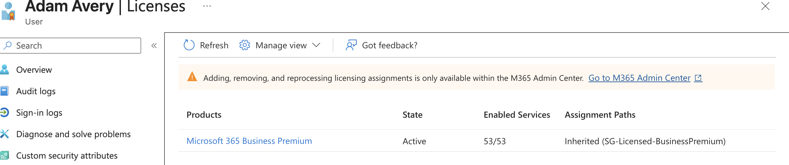
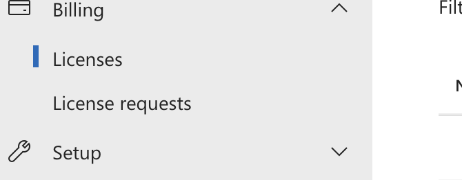
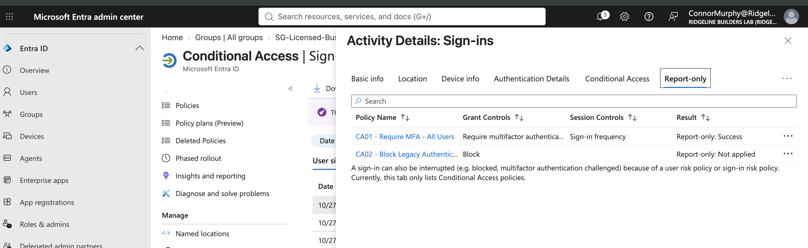
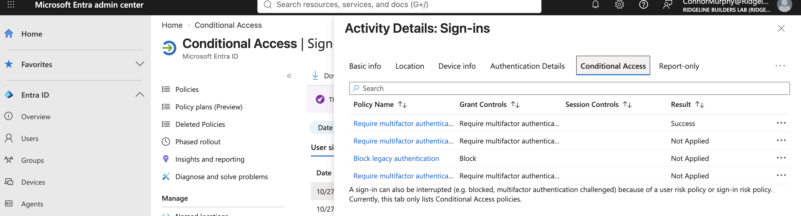
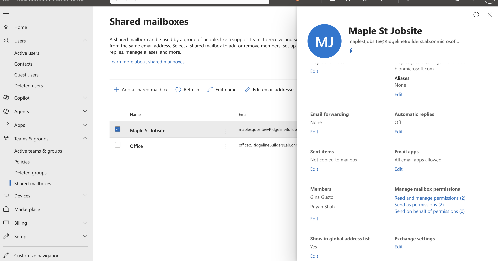
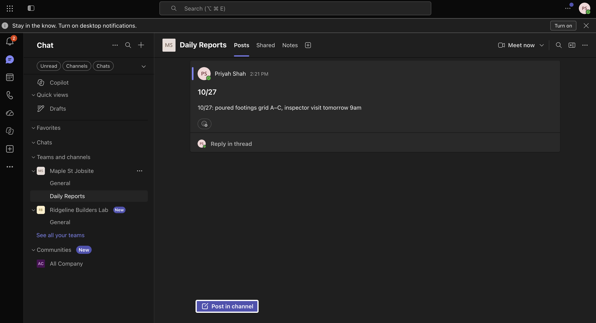

# Project 1: Microsoft 365 / Entra ID Tenant

**Goal:** Stand up Ridgeline's cloud tenant with users, group-based licensing, least-privilege admin roles, a break-glass account, MFA enforced through Conditional Access, shared mailboxes, and Teams.

**What it shows:** Microsoft 365 administration (users, licenses, Exchange Online, Teams), Entra ID, MFA, and least-privilege access.

---

## 1. Tenant setup

I started a Microsoft 365 Business Premium trial (30 days, 25 licenses). Business Premium includes Entra ID P1, needed for Conditional Access and sign-in reporting, and Intune, needed for Project 3.

The first thing I did after signup was **turn off recurring billing**, so the trial expires instead of converting to a paid annual plan. Cost control is part of the job.

## 2. Users and group-based licensing

I created the company's employees with job titles and departments filled in, since my scripts in Project 2 read those fields.

| Group | Purpose | Members |
| --- | --- | --- |
| SG-Office | Office staff | Office manager |
| SG-Operations | PMs and engineers | Project managers, project engineer, assistant PM |
| SG-Field | Superintendents and crew | Superintendents, carpenter |
| SG-IT | IT staff | IT specialist (everyday account) |
| SG-Licensed-BusinessPremium | Licensing | Every licensed employee |

**Problem:** The guide I was following said to assign the license to the group in the Entra admin center, but that option wasn't there.
**Cause:** Since September 2024, license assignment has moved to the Microsoft 365 admin center; the Entra page is now read-only.
**Fix:** Assigned Business Premium to `SG-Licensed-BusinessPremium` from **Billing > Licenses > Groups** in the M365 admin center. After a short processing delay, every member showed the license as **Inherited** rather than Direct.

**Why it matters:** licensing is driven by membership. Add a new hire to the group and they're licensed automatically; remove them and the license is freed. Nobody gets forgotten and no license is wasted.

**Design note:** group-based licensing doesn't pass through nested groups, so each user is added to the license group directly rather than nesting the role groups inside it. Each person sits in two groups: one for their role, one for licensing.

## 3. Least-privilege admin accounts

The IT specialist has **two accounts**:

| Account | Roles | License | Used for |
| --- | --- | --- | --- |
| Everyday account | None | Yes | Email, Teams, normal work |
| Admin account | User Admin, License Admin (later Intune Admin) | **No** | Admin work only |

If the everyday account is phished, the attacker gets one user's mailbox, not the ability to create backdoor accounts, reset passwords, or change security policies. Splitting accounts **limits the blast radius**. The admin account has no mailbox, so there's nothing for a phishing email to land in.

I verified the restrictions by signing in as the admin account:

- ✅ Resetting a regular user's password: allowed
- ❌ Resetting a Global Administrator's password: blocked
- ❌ Billing and most admin areas: hidden

Roles were added only when a task required them. The Intune Administrator role was added in Project 3 for Autopilot device imports.

## 4. Break-glass emergency account

I created a cloud-only emergency Global Administrator on the `onmicrosoft.com` domain. It exists so the company is never fully locked out, whether because of a bad Conditional Access policy, a departed or unreachable admin, compromised admin accounts, or an outside sign-in dependency failing.

- Not tied to any person's name, so it survives staff turnover
- No license and no mailbox
- Long passphrase stored separately
- Excluded from my own Conditional Access policies, so my mistakes can't lock it out
- **Still has MFA:** Microsoft now enforces MFA on admin portals for every account, including break-glass. Microsoft recommends FIDO2 security keys stored in separate secure locations; in the lab I used Authenticator.

**Problem:** registering Authenticator from inside the app looped back to the sign-in screen repeatedly.
**Fix:** started registration from `mysignins.microsoft.com` on the computer and scanned the QR code with the app instead.

The tenant has exactly two Global Administrators: my own account and break-glass.

**In production:** break-glass MFA would live on hardware keys locked away, not on the same phone as my own MFA, because one lost phone would otherwise lock out both. Sign-ins to the account would also trigger an alert, since any use is either a real emergency or an attacker.

## 5. Conditional Access

I disabled security defaults, which can't run alongside Conditional Access, and created two policies, both in **report-only** mode first:

| Policy | Users | Condition | Action |
| --- | --- | --- | --- |
| CA01 - Require MFA - All users | All users, excluding break-glass | All cloud apps | Require MFA |
| CA02 - Block legacy authentication | All users, excluding break-glass | Exchange ActiveSync and Other clients | Block |

Report-only results for a test sign-in were exactly as intended: CA01 **Success** (MFA completed) and CA02 **Not applied** (a browser sign-in isn't a legacy client).

I then switched both policies to **On** and signed in as a test user. The failed attempts (wrong password) showed CA as **Not applied**, because Conditional Access only runs after the password is verified. The successful sign-in showed CA01 **Success** on the enforced Conditional Access tab.

**Notes:**
- Turning off security defaults leaves a brief gap where MFA isn't required. Do it off-hours with the policies prepared in advance.
- Microsoft has already largely disabled legacy authentication in Exchange Online, so CA02 is defense in depth.
- **In production** I'd roll out new or risky policies with a pilot group first: IT plus a few representative users, keeping critical roles like superintendents mid-project out of the first wave, while report-only shows the impact on everyone else.

## 6. Exchange and Teams

**Shared mailboxes:** `office@` (office staff) and `jobsite-maple@` (PM and superintendent). Shared mailboxes under 50 GB need no license.

**Teams:** a private **Maple St Jobsite** team created from the admin center, with the PM and superintendent as owners and the field crew as members. IT is not a member. A **Daily Reports** channel holds the crew's updates.

**When to use which:**
- **Shared mailbox:** communication with people *outside* the company (inspectors, suppliers, the city) who email the jobsite address.
- **Teams channel:** internal conversation and daily updates among the crew.

**Ownership:** every team has two owners so it doesn't become orphaned if one person leaves, and the owners are the business people running the job, not IT, so IT doesn't become the bottleneck for every membership request.

**Problem:** signing in to Teams as the PM failed with "email unrecognized."
**Cause:** I was on the consumer version of Teams (teams.live.com), which doesn't accept work accounts.
**Fix:** signed in at `teams.microsoft.com`.

## 7. End-to-end test

I created a new user, added them to their role group and `SG-Licensed-BusinessPremium`, and confirmed they automatically received the license and were required to register MFA at first sign-in.

<!-- TODO: confirm which user you used for this test (Lauren Harris?) and add a screenshot. -->

## Lessons

- License management moved from Entra to the M365 admin center; admin portals change often, so verify against current documentation.
- Authentication (who you are) and authorization (what you can do) are separate checks.
- Report-only mode and a break-glass account are what make Conditional Access changes safe.
