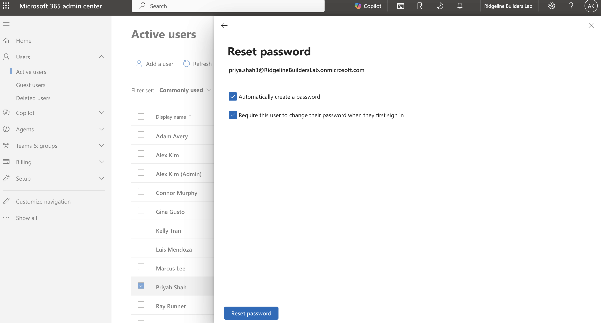

# Project 1: Microsoft 365 / Entra ID Tenant

For this project I set up Ridgeline's Microsoft 365 tenant: users and groups, licensing through group membership, separate admin accounts, an emergency break-glass account, MFA through Conditional Access, shared mailboxes, and a Teams team for a jobsite.

## Tenant setup

I started a Microsoft 365 Business Premium trial (30 days, 25 licenses). I picked Business Premium because it includes Entra ID P1, which Conditional Access needs, and Intune, which I used in Project 3.

Right after signing up I turned off recurring billing so the trial would expire instead of turning into a paid annual plan.

## Users and group-based licensing

I created the employees with job titles and departments filled in, since my Project 2 scripts use those fields. These are the groups I set up:

| Group | Purpose | Members |
| --- | --- | --- |
| SG-Office | Office staff | Office manager |
| SG-Operations | PMs and engineers | Project managers, project engineer, assistant PM |
| SG-Field | Superintendents and crew | Superintendents, carpenter |
| SG-IT | IT staff | IT specialist's everyday account |
| SG-Licensed-BusinessPremium | Licensing | Every licensed employee |

The guide I was using said to assign the license to a group from the Entra admin center, but the option wasn't there. It turns out license assignment moved to the Microsoft 365 admin center in September 2024, and the Entra page is read-only now. I assigned Business Premium to `SG-Licensed-BusinessPremium` under Billing > Licenses > Groups, and after a few minutes every member showed the license as "Inherited" instead of "Direct."

With this setup, adding a new hire to the group licenses them automatically, and removing someone frees the license. One thing I learned is that group licensing doesn't work through nested groups, so each person is added directly to the license group as well as their role group.

## Separate admin accounts

The IT specialist has two accounts. The everyday account has a license and no admin roles, and is used for email and Teams. The admin account has no license (so no mailbox) and only the roles it needs: User Administrator and License Administrator, plus Intune Administrator later in Project 3.

The point is to limit the damage if the everyday account gets phished. An attacker would get one mailbox, but not the ability to reset passwords, create accounts, or change security settings. And since the admin account has no mailbox, there's nothing for a phishing email to land in.

I tested the admin account to make sure the limits actually worked. It could reset a regular user's password, but it couldn't reset a Global Administrator's password, and Billing and most admin areas were hidden.

## Break-glass account

I made a cloud-only emergency Global Administrator account on the `onmicrosoft.com` domain. It's there so the company can still get in if something goes wrong, like a bad Conditional Access policy, an admin leaving, or the main admin accounts getting compromised.

It isn't tied to a person's name, has no license or mailbox, uses a long passphrase stored separately, and is excluded from my Conditional Access policies so my own mistakes can't lock it out. It still has MFA, because Microsoft now requires MFA on admin portals for every account. In the lab I used Authenticator; in a real company it would be hardware security keys kept in separate safe places, so one lost phone can't lock out both my account and the emergency one. Sign-ins to it should also trigger an alert, since nobody should be using it day to day.

Registering Authenticator from inside the app kept looping back to the sign-in screen. Starting from `mysignins.microsoft.com` on the computer and scanning the QR code worked.

The tenant ended up with exactly two Global Administrators: mine and break-glass.

## Conditional Access

I turned off security defaults (they can't run alongside Conditional Access) and created two policies, both in report-only mode to start:

| Policy | Users | Condition | Action |
| --- | --- | --- | --- |
| CA01 - Require MFA - All users | All users except break-glass | All cloud apps | Require MFA |
| CA02 - Block legacy authentication | All users except break-glass | Exchange ActiveSync and other clients | Block |

On a test sign-in, the report-only results came back the way I wanted: CA01 showed Success since MFA was completed, and CA02 showed Not applied since a browser isn't a legacy client.

After that I switched both policies on and signed in as a test user. The attempts where I typed the wrong password showed Conditional Access as Not applied, because it only runs after the password checks out. The successful sign-in showed CA01 as Success.

A few things I'd do differently in a real company. Turning off security defaults leaves a short window with no MFA requirement, so I'd do it after hours with the policies ready to go. For riskier policies, I'd start with a pilot group of IT and a few users, and leave out people like superintendents in the middle of a job. Also, Microsoft has mostly shut off legacy authentication in Exchange Online already, so CA02 is more of a backup layer.

## Exchange and Teams

I made two shared mailboxes: `office@` for office staff and `jobsite-maple@` for the PM and superintendent. Shared mailboxes under 50 GB don't need a license.

I also created a private Maple St Jobsite team from the admin center, with the PM and superintendent as owners and the field crew as members, plus a Daily Reports channel. IT isn't a member.

The way I think about it, the shared mailbox is for people outside the company (inspectors, suppliers, the city) who email the jobsite, and the Teams channel is for the crew talking among themselves. The team has two owners so it isn't stuck if one person leaves, and the owners are the people running the job so IT doesn't have to handle every membership request.

When I tried to sign in to Teams as the PM, I got "email unrecognized." I was on the consumer version of Teams (teams.live.com), which doesn't take work accounts. Signing in at `teams.microsoft.com` fixed it.

## End-to-end test

To check the whole setup, I created a new user, added them to their role group and `SG-Licensed-BusinessPremium`, and confirmed they got the license automatically and had to set up MFA on first sign-in.

<!-- TODO: confirm which user you used for this test (Lauren Harris?) and add a screenshot. -->

## What I learned

Microsoft moves things around in the admin portals a lot, so I had to check current documentation instead of trusting older guides. I also got a clearer picture of authentication (proving who you are) versus authorization (what you're allowed to do), since the Conditional Access logs showed them as separate steps. And report-only mode plus a break-glass account made it a lot less scary to turn on MFA for everyone.
