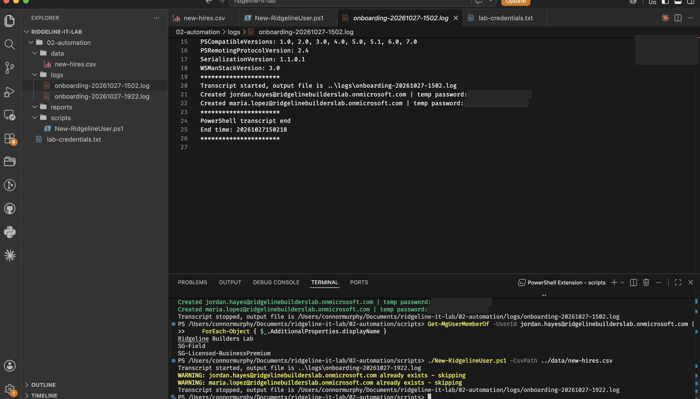
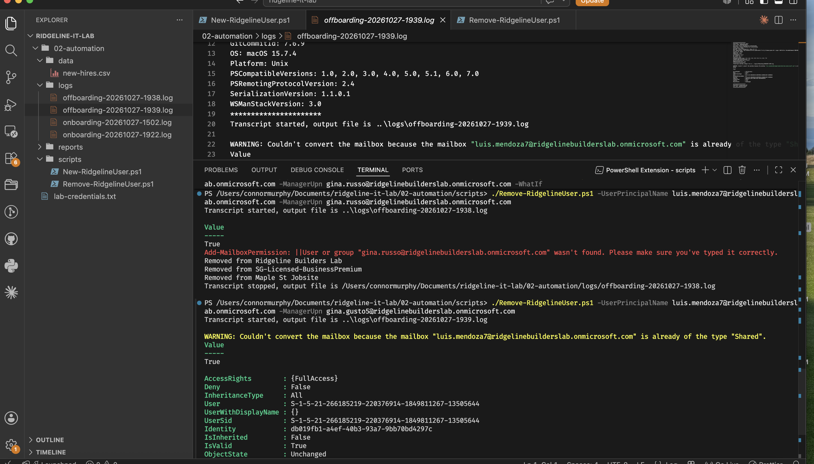
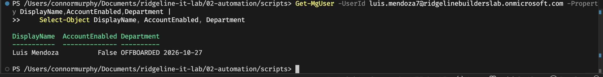
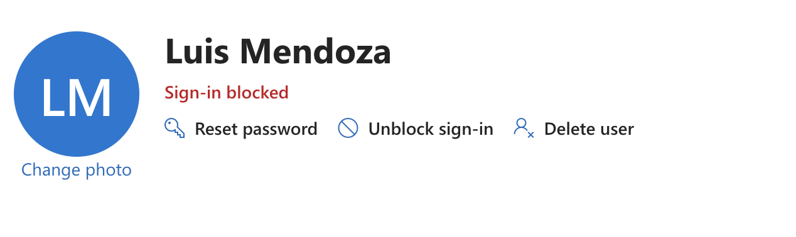
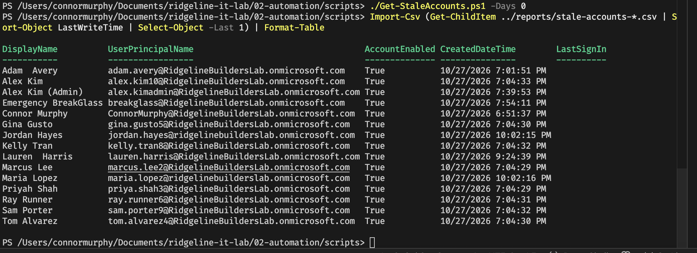
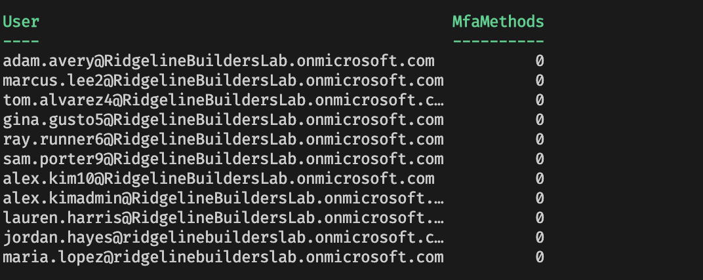
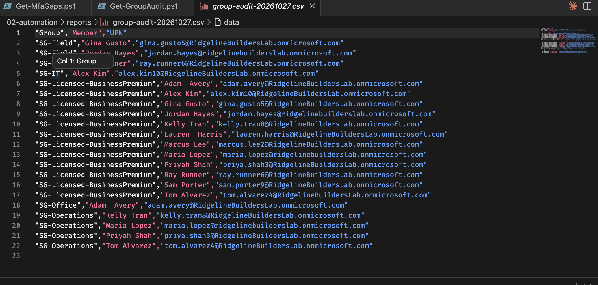

# Project 2: PowerShell Automation with Microsoft Graph

In this project I wrote PowerShell scripts to handle Ridgeline's repetitive account work, so onboarding and offboarding happen the same way every time and don't depend on someone remembering every step.

| Script | What it does |
| --- | --- |
| `New-RidgelineUser.ps1` | Creates users from a CSV and adds them to their role group and the license group |
| `Remove-RidgelineUser.ps1` | Offboards a user: blocks sign-in, signs them out everywhere, converts the mailbox to shared, removes group memberships |
| `Get-StaleAccounts.ps1` | Lists enabled accounts with no sign-in for a set number of days |
| `Get-MfaGaps.ps1` | Lists users who haven't registered MFA |
| `Get-GroupAudit.ps1` | Lists every member of every `SG-` group |

## Setup

I used PowerShell 7 on macOS with VS Code, and the `Microsoft.Graph` and `ExchangeOnlineManagement` modules. (The older `MSOnline` and `AzureAD` modules are retired.) I connect with only the permissions the scripts need:

```powershell
Connect-MgGraph -Scopes "User.ReadWrite.All","Group.ReadWrite.All","Directory.ReadWrite.All","AuditLog.Read.All","UserAuthenticationMethod.Read.All"
```

The first time anyone connects in a tenant, a Global Admin has to approve the Graph PowerShell app for the organization. After that the scripts can run under the IT admin account, which is limited to whatever its admin roles allow.

```
02-automation/
├── scripts/   # the .ps1 files
├── data/      # input CSVs (sample data)
├── reports/   # output CSVs (not committed, they contain user names)
└── logs/      # transcripts (not committed)
```

The scripts build their file paths from `$PSScriptRoot`, so they work no matter which folder you run them from.

## Onboarding

`New-RidgelineUser.ps1` reads a CSV of new hires, creates each account with a temporary password that has to be changed at first sign-in, and adds the user to their role group and `SG-Licensed-BusinessPremium` so they get licensed automatically.

I added a few things to make it safer to use. It supports `-WhatIf`, so you can see what it would do before it does anything. It skips anyone who already exists, so running it twice doesn't create duplicates. And every run is logged with `Start-Transcript`. In the screenshot, the second run skips both users with warnings:



One problem I noticed: the script prints each temporary password, which means the transcript log saves it too. That's okay for a lab, but in a real company the password should go to the manager securely, or be replaced with a Temporary Access Pass, and never end up in a log.

## Offboarding

`Remove-RidgelineUser.ps1` does its steps in a specific order:

1. Block sign-in and revoke sessions. Disabling an account doesn't sign out a phone that's already logged in, but `Revoke-MgUserSignInSession` does.
2. Convert the mailbox to shared and give the manager access. This has to happen before licenses are removed, because removing the license first means the mailbox gets deleted after a grace period.
3. Remove the user from all groups, which also frees up the license.
4. Set the department field to `OFFBOARDED <date>` so the next admin can see what happened.

The account gets disabled instead of deleted, so it's easy to bring back if needed.





I ran into two problems here. The first time, the script seemed to run fine but nothing actually changed. I had reused the previous command, which still had `-WhatIf` on the end, so it was only a dry run. The giveaway was that no log file got created. Later, a run gave me a warning that the mailbox was "already Shared." That just meant the earlier real run had worked and the admin center was showing an old cached page. Checking the account directly with `Get-MgUser` confirmed it was disabled.

## Stale accounts

`Get-StaleAccounts.ps1` exports enabled accounts that haven't signed in within a set number of days (90 by default). Accounts less than 14 days old are skipped so new hires don't get flagged on day one.

Since my tenant was brand new, I tested it with `-Days 0` and the 14-day filter turned off. Every enabled account showed up, and the offboarded user didn't, which is what I expected.



At first the report came back empty. I checked each part of the pipeline separately and found that my `#` had only commented out the end of the line, so the 14-day filter was still running. I also noticed the LastSignIn column was blank even for users who had signed in, since sign-in data takes a while to show up in a new tenant. In a real setup I'd leave the break-glass account out of this report, since it's supposed to look unused, and watch it with an alert instead.

## MFA gaps

`Get-MfaGaps.ps1` uses Microsoft's MFA registration report to list users without MFA. The report came back empty at first because Microsoft builds it in the background and it can take up to a day in a new tenant. An empty file could mean everyone has MFA or that there's no data yet, so I changed the script to warn and stop when the report has no data, and to print a summary of how many users it checked.

For a real-time answer, I also checked each user's registered sign-in methods directly:



<!-- TODO: this result shows the admin account with 0 MFA methods. Re-run it and either document fixing it or explain the result. -->

The report is faster and works well for a weekly check across lots of users, but it's cached. Checking each user directly is always up to date but makes one request per user, so it's better for checking one person, like someone on the phone with the help desk.

## Group audit

`Get-GroupAudit.ps1` exports every member of every `SG-` group to a CSV. I wrote it after an app deployment in Project 3 failed because a superintendent was never added to `SG-Field`. Running this monthly would catch mistakes like that.



## What I learned

A dry run and a successful run can look almost the same, so it's worth having scripts print a clear summary and then checking the result yourself. Relative paths break depending on where you run a script from, which `$PSScriptRoot` fixes. Microsoft's report data lags in a new tenant, so it helps to know which data is live and which isn't. And when a command complains about an empty value, the first thing to check is whether that variable was ever actually set.
