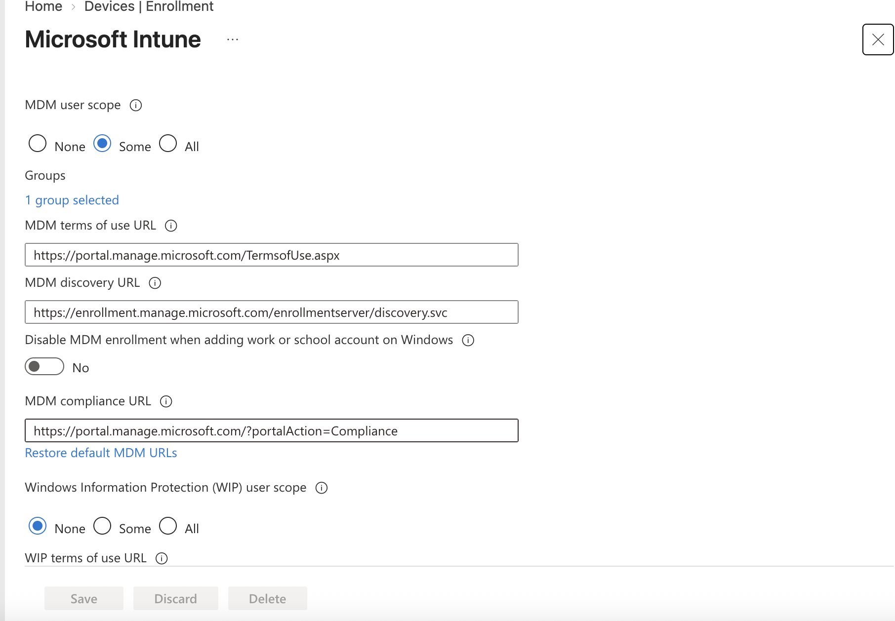
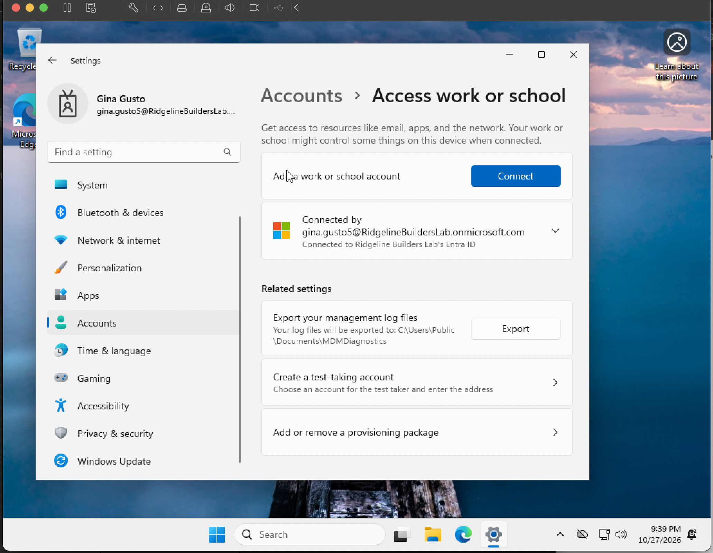
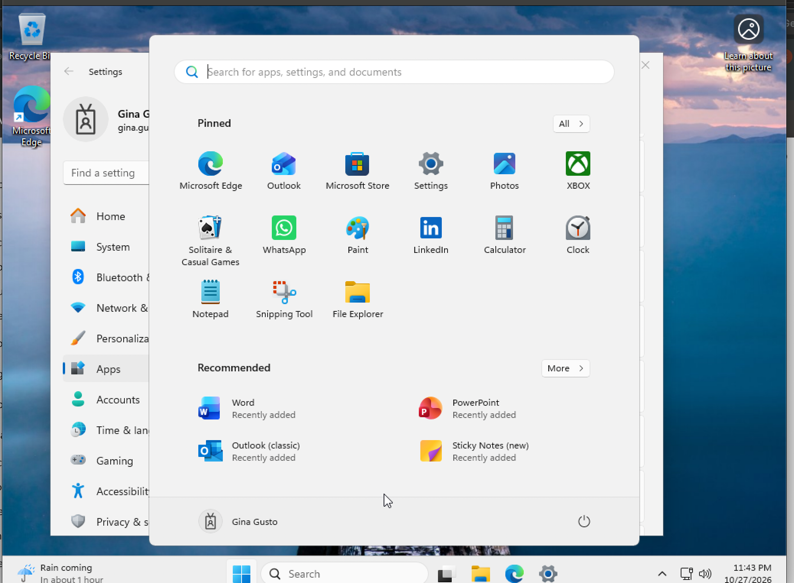
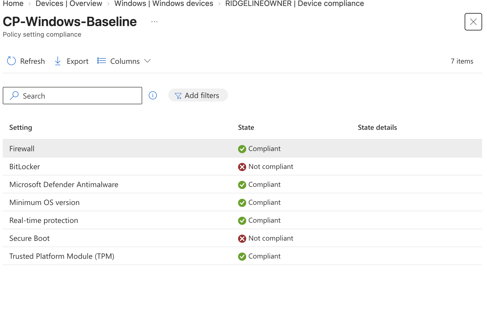
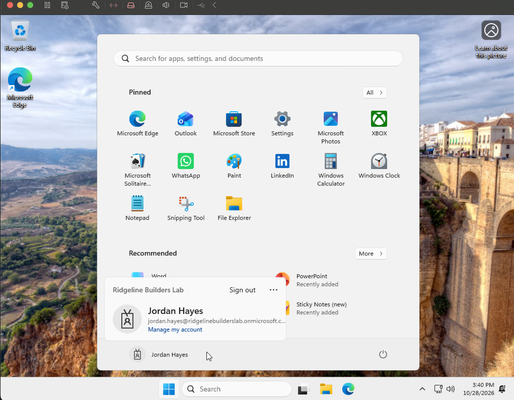
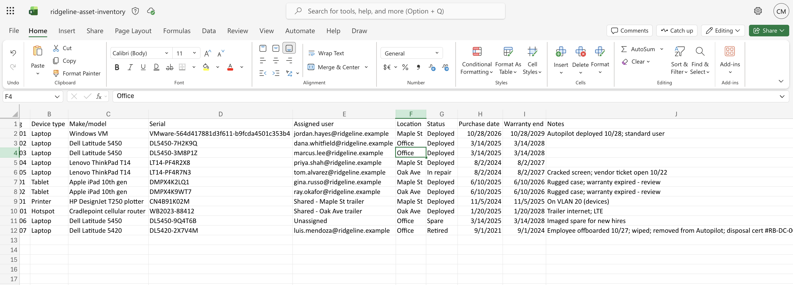

# Project 3: Intune Device Management and Autopilot

**Goal:** Enroll a Windows laptop into Intune, enforce compliance and configuration, deploy patches and apps, redeploy it hands-free with Autopilot, and track it in an asset inventory.

**What it shows:** the full device lifecycle (deployment, imaging, patching, asset tracking, and retirement), plus structured troubleshooting.

## Environment

- **VMware Fusion** on an Apple Silicon (M3) Mac, which can only run the Arm64 build of Windows 11
- **Windows 11 Pro (Arm64)**, installed with "I don't have a product key." Pro rather than Home, because Home can't join Entra ID the way company laptops do.
- 4 CPU cores, 8 GB RAM, 64 GB disk, virtual TPM (enabled by encrypting the VM in Fusion)
- A snapshot named **"Fresh OOBE"** at the first setup screen, so I could return to an unconfigured machine at any time

**Problem:** the VM booted to an "EFI Network" timeout screen instead of the installer.
**Cause:** it missed the brief "press any key to boot from CD" prompt and fell back to network boot.
**Fix:** restarted and pressed a key immediately, and set the startup disk to CD/DVD for the install. (This setting caused a problem later; see the BitLocker log.)

## 1. Preparing Intune

- **Automatic enrollment:** MDM user scope set to **Some** → `SG-Licensed-BusinessPremium`, so any licensed employee who signs in to Windows with a work account enrolls the device. The WIP scope stays at None (WIP is retired).
- **Dynamic device group** `DG-Windows-Laptops` with the rule `(device.deviceOSType -eq "Windows")`, so every Windows device joins automatically.

## 2. Enrolling the device

I signed in to the VM as a superintendent, not as an administrator. A laptop's primary user should be the employee who carries it; signing in with a Global Admin would tie high-level permissions to a device that could be phished or stolen.

The device joined Entra ID and appeared in Intune with the superintendent as primary user.

## 3. Policies, patching, and apps

| Item | Name | Assigned to | Settings |
| --- | --- | --- | --- |
| Compliance policy | CP-Windows-Baseline | DG-Windows-Laptops | BitLocker, Secure Boot, firewall, Defender antimalware, real-time protection, TPM, minimum OS version; noncompliant after a **1-day grace period** |
| Configuration profile | <!-- TODO: your profile name --> | DG-Windows-Laptops | <!-- TODO: the settings you chose, e.g. screen lock after 10 minutes, consumer features off --> |
| Disk encryption | BitLocker policy | DG-Windows-Laptops | Silent encryption of the OS drive |
| Update ring | Ring-Broad | DG-Windows-Laptops | Quality updates deferred 3 days, feature updates 30 days |
| App | Microsoft 365 Apps (64-bit) | SG-Field (Required) | |

**The grace period:** a laptop can briefly fail a check after an update or reboot; a superintendent shouldn't be blocked mid-morning over a hiccup.

**Update rings:** in production I'd add a **Ring-Pilot** with no deferral for IT's own devices, so patches are tested before they reach the field.

**App assignment:** Microsoft 365 Apps targets SG-Field here so I could watch it deploy to the test user. In production it would go to all licensed users or all company laptops, and role groups would target specialized apps like Bluebeam or Procore.

**Problem:** the app never deployed, and Intune's install status showed zero devices, not even pending.
**Cause:** the superintendent had never been added to SG-Field, so the assignment had no one to deliver to on that device.
**Fix:** added the user to SG-Field, then wrote the group audit script (Project 2) so missed memberships get caught.

## 4. Compliance troubleshooting: BitLocker and Secure Boot

**Summary:** the VM reported non-compliant on BitLocker and Secure Boot. The BitLocker policy delivered successfully, but the drive never encrypted.

| # | Step | Finding |
| --- | --- | --- |
| 1 | Checked device compliance after the first sync | The overview said **Compliant**, but the built-in Default policy flagged "Has a compliance policy assigned." It was a **false positive**: my policy hadn't reached the device yet. |
| 2 | Confirmed group membership and assignment; waited for delivery | Policy arrived: **Not compliant** on BitLocker and Secure Boot |
| 3 | Created an Endpoint security BitLocker policy | A compliance policy only *checks*; a separate policy is needed to *enforce* |
| 4 | `manage-bde -status C:` | Fully Decrypted. Encryption never started. |
| 5 | `Get-Tpm` | TpmPresent and TpmReady both True |
| 6 | Event Viewer (BitLocker-API > Management) | "TPM is not available" and "bootable media detected" |
| 7 | Detached the installer ISO and set the startup disk back to the hard drive | Bootable-media error gone; a Secure Boot validation error remained |
| 8 | `msinfo32` | Secure Boot State: **Off** |
| 9 | Enabled UEFI Secure Boot in Fusion | Secure Boot **On**, but BitLocker still failed |
| 10 | `msinfo32` run as administrator | **PCR7 Configuration: Not available** |

**Root cause:** VMware Fusion's Apple Silicon virtual firmware doesn't provide the PCR7 boot measurements BitLocker uses to seal its key to the TPM, so silent encryption fails regardless of policy.

**Status: Closed.** Known VM limitation. Policy targeting and delivery are confirmed working. In production I'd validate on a physical pilot laptop, where PCR7 binding is standard.

**Lessons:**
- A "Compliant" badge isn't proof. Check per-policy results.
- Compliance policies report; configuration and endpoint security policies enforce.
- "Policy succeeded" means *delivered*, not *applied*. The device's own logs show what Windows actually did.
- Leftover installation media blocks BitLocker, on real laptops too.

## 5. Autopilot redeployment

**How it works:** the device's hardware hash, a fingerprint of the machine, is registered to the company. When a device with that fingerprint reaches Windows setup and connects to the internet, Microsoft recognizes it and applies the company's deployment profile. Vendors can upload hashes at the factory, so a laptop can ship directly to an employee and configure itself on first sign-in.

**Setup:**
1. Captured the hardware hash in an admin PowerShell with `Get-WindowsAutopilotInfo`.
2. Imported it in Intune as the IT admin account after granting it **Intune Administrator**.
3. Created a dynamic device group **DG-Autopilot**: `(device.devicePhysicalIDs -any (_ -startsWith "[ZTDId]"))`, meaning any Autopilot-registered device.
4. Created deployment profile **AP-Ridgeline-Standard**: user-driven, Entra joined, license and privacy screens hidden, **standard user** accounts, device name template `RB-%RAND:6%`. Assigned to DG-Autopilot.
5. Waited for the device's profile status to show **Assigned**.

**Why standard users:** employees can't install unapproved software, and malware running as the user can't change the system.

**Why `%RAND:6%` instead of `%SERIAL%`:** Windows device names max out at 15 characters, and VM serial numbers are long.

### Troubleshooting log: profile not applied

| # | Step | Finding |
| --- | --- | --- |
| 1 | Imported the hash as the IT admin account | "No permission." The role had just been granted; the account's existing session predated it. Signing out and back in fixed it. |
| 2 | Restored the "Fresh OOBE" snapshot and booted | Generic Windows setup appeared, not the company flow |
| 3 | Shift+F10 at setup; `reg query HKLM\SOFTWARE\Microsoft\Provisioning\Diagnostics\Autopilot` | `IsAutoPilotDisabled = 0`, but **CloudAssignedTenantDomain blank**: no profile delivered |
| 4 | `ping microsoft.com` | Network OK |
| 5 | Compared the BIOS serial (`Get-CimInstance Win32_BIOS`) with the Intune record | Serials matched |
| 6 | Waited overnight and restarted at setup | **CloudAssignedTenantDomain populated.** The cloud had needed time to make the assignment available to devices. |
| 7 | Restored the snapshot again | Tenant domain blank again. **A snapshot restore discards the cached profile**, because the snapshot predates the download. |
| 8 | Let setup download the profile, then *restarted* (not restored) | `CloudAssignedOobeConfig` populated; setup went straight to the work sign-in, skipping the personal/work choice |

**Root cause:** timing (profile availability lagged behind "Assigned" in the portal), compounded by restoring a snapshot that predated the cached profile.

**Result:** a new hire signed in on the redeployed device and received the company configuration and Microsoft 365 apps without any manual setup.

<!-- TODO: add a screenshot showing the RB- device name (Settings > System > About) and the user as a Standard user. -->

**Lessons:**
- "Assigned" in the portal doesn't mean the device can receive the profile yet.
- Know what state a machine is actually in: a restore and a restart are not the same thing.
- Registry evidence beats guessing.

## 6. Asset inventory

I exported the device from Intune and built `ridgeline-asset-inventory.xlsx`. The export is what Intune *knows*; the inventory is what the business *needs*: location, warranty, status, and notes. Most rows are simulated devices.

The sheet shows the full lifecycle: deployed, spare, in repair (with a vendor ticket), and retired (wiped, removed from Autopilot, disposal certificate recorded). Two tablets with expired warranties are flagged for review, because an inventory should prompt action, not just list things.

The redeployment replaced the old enrollment record rather than creating a second one, since Intune recognized the same hardware.

