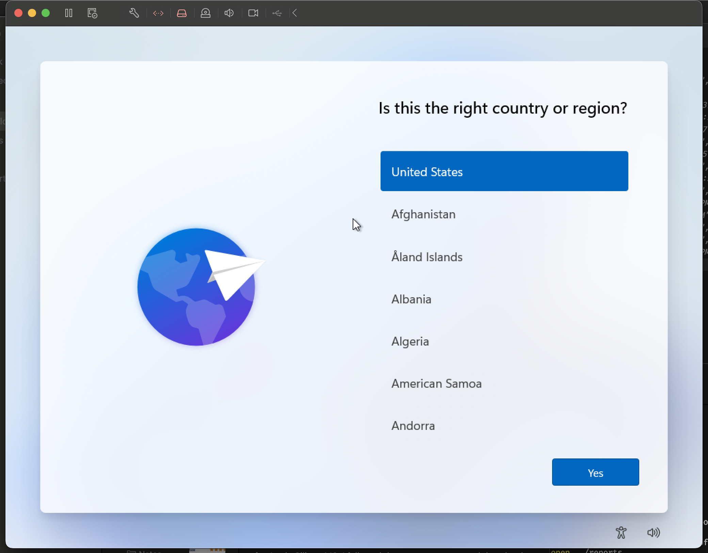
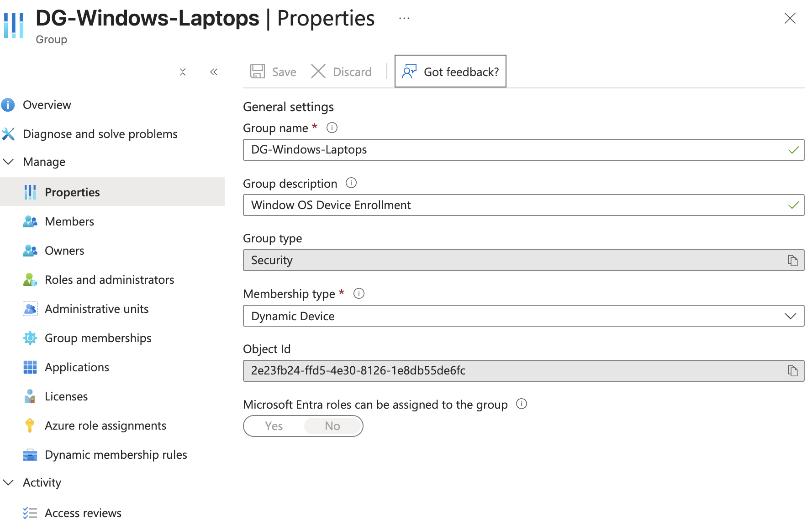
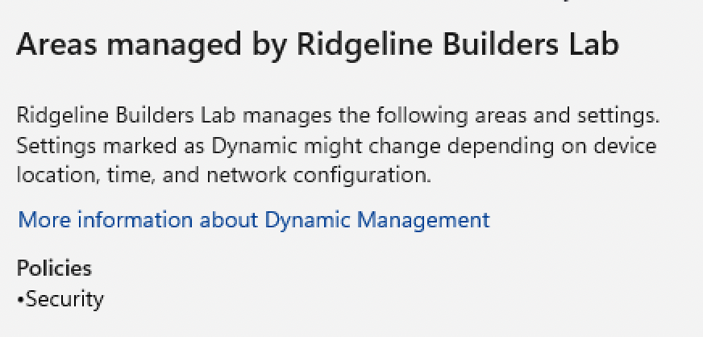

# Project 3: Intune Device Management and Autopilot

In this project I enrolled a Windows laptop into Intune, set up compliance, encryption, update, and app policies, redeployed the laptop with Autopilot so it set itself up, and tracked it in an asset inventory.

## The VM

I'm on an M3 Mac, which can only run the Arm64 version of Windows 11, so I used VMware Fusion with Windows 11 Pro (Arm64). I installed it without a product key. I used Pro instead of Home because Home can't join Entra ID like a company laptop does. The VM has 4 CPU cores, 8 GB of RAM, a 64 GB disk, and a virtual TPM, which Fusion adds when you encrypt the VM.

I took a snapshot called "Fresh OOBE" at the first setup screen so I could get back to a clean, unconfigured machine whenever I needed to.

The first boot went to an "EFI Network" timeout screen instead of the installer. It had missed the short "press any key to boot from CD" prompt and tried to boot from the network instead. Restarting and pressing a key right away got me into the installer. (I also set the startup disk to the CD, which caused a problem later. See the BitLocker section.)

## Preparing Intune

I set automatic enrollment's MDM user scope to `SG-Licensed-BusinessPremium`, so any licensed employee who signs in to Windows with their work account gets the device enrolled. I left the WIP scope at None since WIP is retired.

I also created a dynamic device group, `DG-Windows-Laptops`, with the rule `(device.deviceOSType -eq "Windows")`, so every Windows device joins it automatically.

## Enrolling the device

I signed in to the VM as a superintendent instead of as an admin. The main user on a laptop should be the person who actually carries it. Signing in with a Global Admin account would tie a lot of permissions to a device that could get lost, stolen, or phished.

The VM joined Entra ID and showed up in Intune with the superintendent as its primary user.

## Policies, patching, and apps

Here's what I assigned:

- Compliance policy `CP-Windows-Baseline`, assigned to `DG-Windows-Laptops`: requires BitLocker, Secure Boot, the firewall, Defender antivirus with real-time protection, a TPM, and a minimum Windows version. Devices get a one-day grace period before they're marked noncompliant, so a laptop that fails a check after an update doesn't block someone right away.
- Configuration profile <!-- TODO: your profile name and settings -->, assigned to `DG-Windows-Laptops`.
- A BitLocker disk encryption policy, assigned to `DG-Windows-Laptops`, to turn on encryption silently.
- Update ring `Ring-Broad`: quality updates delayed 3 days and feature updates 30 days. In a real company I'd add a `Ring-Pilot` with no delay for IT's own laptops, so updates get tested before they reach everyone else.
- Microsoft 365 Apps (64-bit), required for `SG-Field`. I targeted that group so I could watch it install for my test user. In a real company it would go to all licensed users, and role groups would be used for specialized apps like Bluebeam or Procore.

The apps never installed at first, and Intune showed zero devices, not even pending. The superintendent had never been added to `SG-Field`, so the assignment had nobody to go to on that device. After I added the user to the group, it installed. That's also why I wrote the group audit script in Project 2.

## Troubleshooting BitLocker and Secure Boot

The VM kept showing as noncompliant on BitLocker and Secure Boot. The BitLocker policy said it was delivered, but the drive never got encrypted.

Here's how I worked through it:

1. The device overview first said "Compliant," but the built-in default policy showed "Has a compliance policy assigned" with an error. My policy hadn't actually reached the device yet, so the "Compliant" status was misleading.
2. I confirmed the VM was in the right group and the policy was assigned, then waited. When the policy arrived, it marked the device noncompliant on BitLocker and Secure Boot.
3. A compliance policy only checks settings; it doesn't change them. So I created a separate BitLocker policy under Endpoint security to actually turn encryption on.
4. `manage-bde -status C:` showed the drive was still fully decrypted, and `Get-Tpm` showed the TPM as present and ready.
5. Event Viewer (BitLocker-API > Management) had two errors: "TPM is not available" and "bootable media detected." The Windows install ISO was still attached as a virtual CD, and the startup disk was still set to the CD.
6. I disconnected the CD and set the startup disk back to the hard drive. The bootable media error went away, but a new one said BitLocker couldn't validate the Secure Boot state.
7. `msinfo32` showed Secure Boot was off, so I turned on UEFI Secure Boot in Fusion. Secure Boot showed as on after that, but BitLocker still failed.
8. Running `msinfo32` as administrator showed "PCR7 Configuration: Not available."

The root cause is that VMware Fusion's virtual firmware on Apple Silicon doesn't provide the PCR7 boot measurements that BitLocker uses to lock its key to the TPM, so silent encryption can't work no matter what the policy says. I closed this as a VM limitation. The policies were assigned and delivered correctly, and in a real company I'd test this on a physical laptop.

Things I took away from this: a "Compliant" badge isn't proof of anything until you check the individual policies, a policy showing "succeeded" only means it was delivered, and the device's own logs are where you find out what actually happened. Also, leaving install media attached blocks BitLocker on real laptops too.

## Autopilot

Autopilot works off a hardware hash, basically a fingerprint of the machine. Once that hash is registered to the company, the device gets the company's setup profile the first time it reaches Windows setup and connects to the internet. Vendors can upload hashes at the factory, so a laptop can be shipped straight to an employee and set itself up when they sign in.

Setup steps:

1. Captured the hardware hash in an admin PowerShell window with `Get-WindowsAutopilotInfo`.
2. Imported it into Intune using the IT admin account, after giving that account the Intune Administrator role.
3. Created a dynamic device group, `DG-Autopilot`, with the rule `(device.devicePhysicalIDs -any (_ -startsWith "[ZTDId]"))`, which matches any device registered in Autopilot.
4. Created a deployment profile, `AP-Ridgeline-Standard`: user-driven, Entra joined, license and privacy screens hidden, users set up as standard users, and device names using the template `RB-%RAND:6%`. Assigned it to `DG-Autopilot`.
5. Waited until the device's profile status showed "Assigned."

I set users up as standard users so they can't install unapproved software, and malware running as that user can't change system settings. I used a random suffix for the device name instead of the serial number because Windows names max out at 15 characters and VM serial numbers are long.

### Getting the profile to actually apply

This took some troubleshooting:

1. The first import attempt said I didn't have permission. I had just given the admin account the Intune role, but its existing sign-in session was from before that. Signing out and back in fixed it.
2. I restored the "Fresh OOBE" snapshot and booted, but got the normal Windows setup instead of the company flow.
3. At the setup screen I pressed Shift+F10 and checked the registry with `reg query HKLM\SOFTWARE\Microsoft\Provisioning\Diagnostics\Autopilot`. Autopilot wasn't disabled, but `CloudAssignedTenantDomain` was blank, so no profile had been downloaded.
4. `ping microsoft.com` worked, and the BIOS serial number (from `Get-CimInstance Win32_BIOS`) matched the record in Intune.
5. I waited overnight and restarted at setup. This time `CloudAssignedTenantDomain` was filled in. The cloud side had just needed more time even though the portal already said "Assigned."
6. Then I restored the snapshot again, and the tenant domain was blank again. The snapshot was taken before the profile was downloaded, so restoring it threw away the cached profile.
7. I let setup download the profile and then restarted instead of restoring. `CloudAssignedOobeConfig` was filled in, and setup went straight to the work sign-in screen, skipping the personal/work choice.

So the cause was a delay between the portal saying "Assigned" and the profile actually being available, made worse by restoring a snapshot from before the profile was cached.

After that, a new hire signed in on the redeployed device and got the company setup and Microsoft 365 apps without me doing anything manually.

<!-- TODO: add a screenshot showing the RB- device name (Settings > System > About) and the user as a Standard user. -->

## Asset inventory

I exported the device from Intune and used it to build `ridgeline-asset-inventory.xlsx`. The Intune export has the technical details, and the inventory adds what the business cares about: location, warranty, status, and notes. Most of the rows are made-up devices.

The sheet covers the whole lifecycle: deployed, spare, in repair (with a vendor ticket), and retired (wiped, removed from Autopilot, with a disposal certificate number). Two tablets are flagged because their warranties have expired.

The redeployment replaced the old enrollment record instead of creating a second one, since Intune recognized it as the same hardware.

