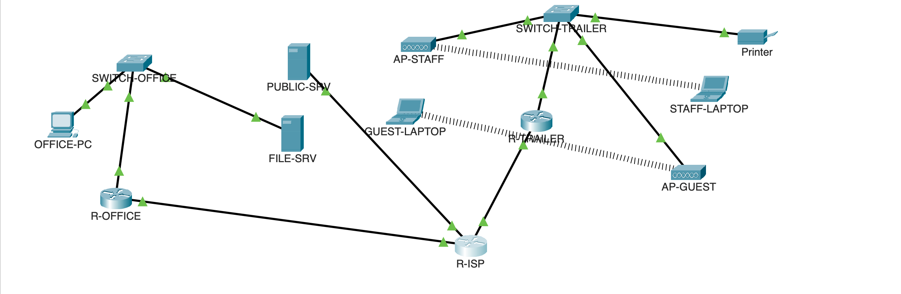
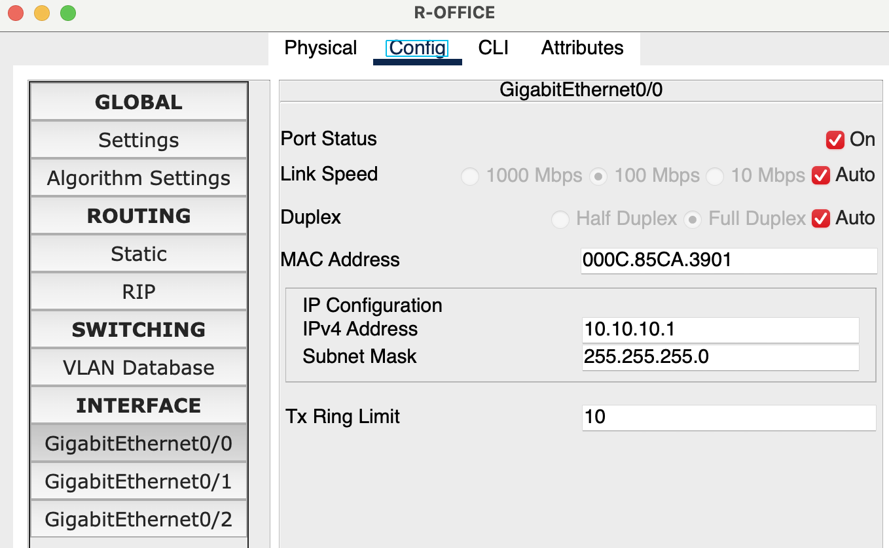
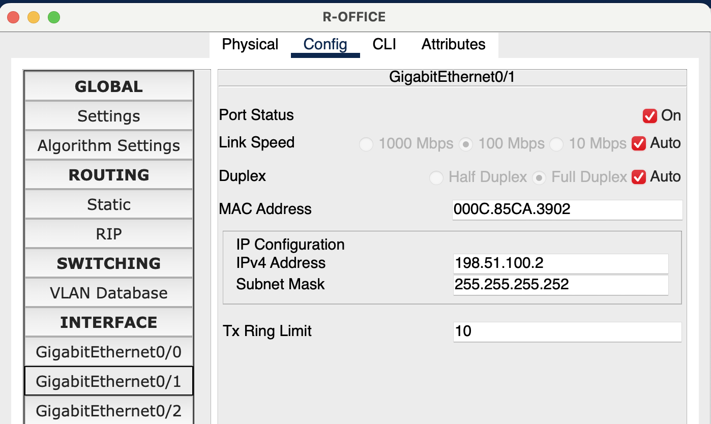
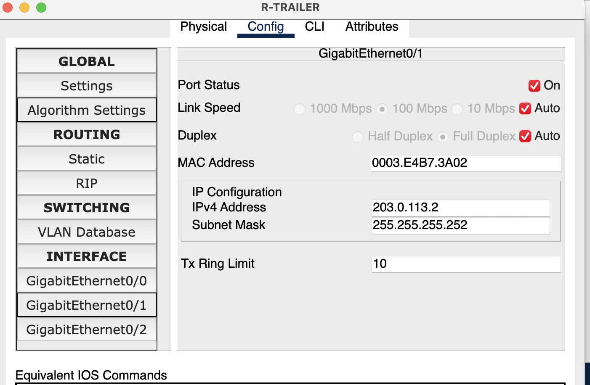
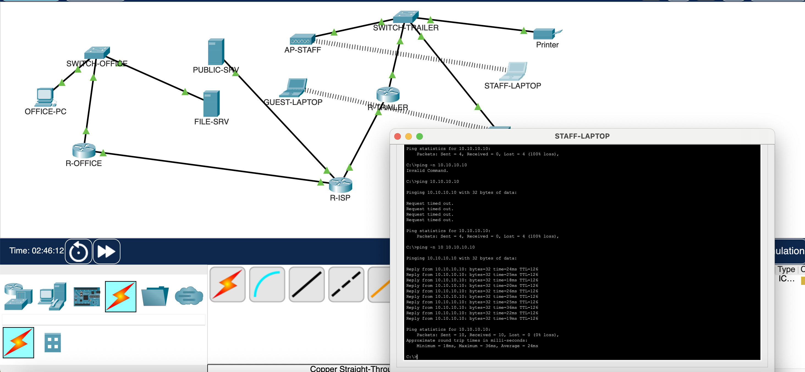
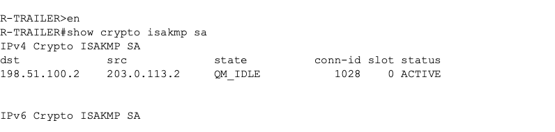
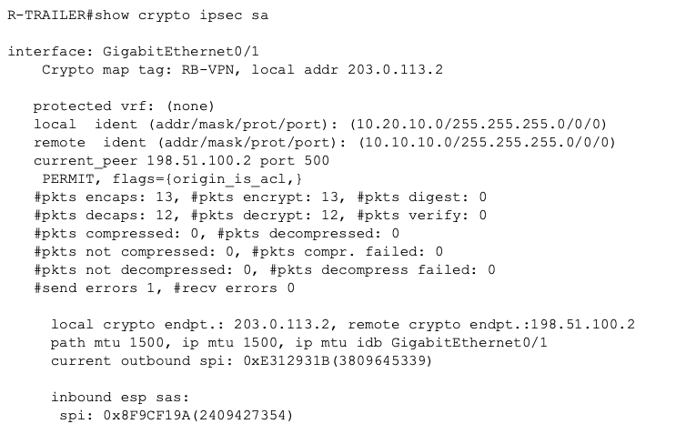

# Project 4: Jobsite Trailer Network (Cisco Packet Tracer)

**Goal:** Design and configure a jobsite trailer network that connects back to the office: separate networks for staff, devices, and guests, automatic addressing, guest isolation, internet access, and an encrypted site-to-site VPN.

**What it shows:** troubleshooting office and jobsite connectivity (Wi-Fi, switches, routers, trailer setups), firewalls, and VPN.

## Files

- `ridgeline-jobsite.pkt`: the Packet Tracer project
- `configs/`: each router and switch's running config as plain text, readable without Packet Tracer

> The VPN pre-shared key appears in the router configs. It's a lab-only key used nowhere else; in production, keys never go in a repository.

## Address plan

| Network | VLAN | Subnet | Gateway | Used for |
| --- | --- | --- | --- | --- |
| Trailer staff | 10 | 10.20.10.0/24 | 10.20.10.1 | Laptops, tablets |
| Trailer devices | 20 | 10.20.20.0/24 | 10.20.20.1 | Plan printer, cameras |
| Trailer guest | 30 | 10.20.30.0/24 | 10.20.30.1 | Subs, inspectors, visitors |
| Office LAN | n/a | 10.10.10.0/24 | 10.10.10.1 | Office PCs, file server |
| Office WAN | n/a | 198.51.100.0/30 | ISP .1, office .2 | Office internet link |
| Trailer WAN | n/a | 203.0.113.0/30 | ISP .1, trailer .2 | Trailer internet link |
| "Internet" | n/a | 8.8.8.0/24 | 8.8.8.1 | Public test server .8 |

The 198.51.100.x and 203.0.113.x ranges are reserved for documentation, so they safely stand in for real public addresses.

**Why three trailer VLANs:** This was intentional in the case of an “infected” device joining the public wifi. The infection would be unable to see any other sensitive information.

## Part D: Internet and office

<<<<<<< HEAD
**ISP-R (the simulated internet)** has three interfaces: one facing the office (198.51.100.1), one facing the trailer (203.0.113.1), and one for the public test server (8.8.8.1). It intentionally has no routes to any 10.x network, which is realistic: the internet doesn't know about a company's private addresses. That's exactly why the trailer needs NAT to reach the internet and a VPN to reach the office.

**PUBLIC-SRV** has static IP 8.8.8.8 with HTTP and DNS turned on, acting as "the internet" for testing.

**R-OFFICE:** G0/0 is the office LAN gateway (10.10.10.1) and G0/1 is the office's internet link (198.51.100.2). A default route sends anything non-local to ISP-R. I also turned off domain lookup so a typo in the CLI doesn't freeze the router while it tries to resolve the mistake as a hostname.

**FILE-SRV and Office-PC** have static IPs on the office LAN (10.10.10.10 and 10.10.10.20) with 10.10.10.1 as the gateway. The file server is what jobsite staff reach through the VPN.

## Part E: Trailer switch VLANs

**SW-TRAILER** has three VLANs: 10 for staff, 20 for devices like the plan printer, and 30 for guests. Each switch port is an access port in exactly one VLAN:

| Port | Connected to | VLAN |
| --- | --- | --- |
| Fa0/1 | Staff access point | 10 |
| Fa0/2 | Guest access point | 30 |
| Fa0/3 | Printer | 20 |
| G0/1 | R-TRAILER | Trunk (all three) |

The trunk carries all three VLANs over one cable and tags each frame so the router knows which network it belongs to. Port assignment is part of the security design, not just cabling: plugging the guest access point into the wrong port would put guests on the staff network.

## Part F: Trailer router

**Subinterfaces (router-on-a-stick):** one physical port, G0/0, with three subinterfaces, one per VLAN: G0/0.10 (10.20.10.1), G0/0.20 (10.20.20.1), and G0/0.30 (10.20.30.1). Each is the gateway for its VLAN, so one router port serves all three networks over the trunk.

**WAN and default route:** G0/1 is the trailer's internet link (203.0.113.2), with a default route pointing to ISP-R.

**DHCP:** a pool for each VLAN, each with its own gateway and 8.8.8.8 as DNS. The first ten addresses in each subnet are excluded so they stay free for devices that need a fixed address.

**Guest isolation (ACL 130):** applied inbound on the guest subinterface. Guest traffic headed to any 10.x address is dropped; everything else is allowed. Guests get internet but can't reach the staff network, the printer, or the office. ACLs are read top to bottom and stop at the first match, so the deny line has to come first.

**NAT (ACL 120):** lets every trailer device share the single public address on G0/1. The NAT ACL has one important exception: staff traffic headed to the office (10.20.10.0 → 10.10.10.0) is excluded from NAT so it keeps its real addresses and can go through the VPN instead of being translated.

## Part G: Wi-Fi

Each access point broadcasts its own SSID, `Ridgeline-Staff` and `Ridgeline-Guest`, secured with WPA2-PSK and separate passphrases. The access points do no VLAN configuration themselves; each one bridges whatever VLAN its switch port is in. Laptops use WPC300N wireless cards and get addresses by DHCP.

**Results:** the guest laptop received a 10.20.30.x address, the staff laptop a 10.20.10.x address, and the printer a 10.20.20.x address. The guest laptop loaded the public test page at `http://8.8.8.8` through NAT.

### Troubleshooting: guest laptop got 169.254.8.201

**Problem:** the guest laptop showed 169.254.8.201. A 169.254 address is self-assigned: the device asked for DHCP, got no answer, and made one up.
**Cause:** I had misnamed the SSID on AP-GUEST, so the laptop couldn't find a network matching its configured name, and the wireless link dropped.
**Fix:** corrected the SSID; the laptop rejoined and received a 10.20.30.x address.
**Lesson:** "Connected but nothing works" with a 169.254 address means DHCP never answered. Check the wireless connection and SSID first, then the VLAN, the subinterface, and the DHCP pool.

### Troubleshooting: four DHCP leases instead of three

`show ip dhcp binding` listed four devices when I expected three. Both access points start with the same default SSID, so before I named them, the guest laptop most likely joined the staff network and received a staff lease. When it moved to the guest network, the router kept the old lease until it expires.

`clear ip dhcp binding *` isn't supported in Packet Tracer. Along the way I learned that `clear` commands only run in privileged EXEC mode (the `#` prompt), and that typing `?` after any part of a command lists the options the device actually supports.

**Security takeaway:** a guest device briefly sat on the staff network because of a naming mix-up. Unique SSIDs and passphrases from the start, and reviewing the DHCP binding table, prevent and catch that.

## Part H: Site-to-site VPN

An IPsec tunnel between R-TRAILER and R-OFFICE lets trailer staff reach the office file server with their traffic encrypted across the internet.

| Piece | What it does |
| --- | --- |
| Security license (`securityk9`) | Enables the router's encryption features; requires a reload |
| ISAKMP policy (Phase 1) | How the routers authenticate each other and secure their negotiation: AES-256, SHA, pre-shared key, DH group 5 |
| Pre-shared key | The shared secret, tied to the *other* router's public IP |
| Transform set (Phase 2) | How the actual data is encrypted: ESP AES-256 with SHA-HMAC |
| ACL 110 ("interesting traffic") | Only staff → office traffic enters the tunnel; guests and the printer never do |
| Crypto map | Bundles the peer, transform set, and ACL; applied to each router's internet-facing port |

The configs on the two routers mirror each other: the key's address, the peer, and ACL 110 all point at the other side. *(DH group 5 is outdated; real deployments use group 14 or higher, but Packet Tracer's options are limited.)*

### Results

The staff laptop reached the office file server with 0% loss, and the tunnel shows as established (**QM_IDLE**) with packets encrypted and decrypted in both directions.

The one send error in the IPsec counters is the first packet, dropped while the tunnel was still being built.

### Troubleshooting log: VPN pings failing

| # | Step | Finding |
| --- | --- | --- |
| 1 | `show crypto ?` | Only offered `key`. The securityk9 license wasn't active, so every crypto command I'd pasted was silently rejected. Activated the license on both routers, saved, and reloaded. |
| 2 | `show crypto map` on R-TRAILER | Empty. Only ACL 110 had survived the original paste, because plain access lists don't need the license. Re-entered the crypto config. |
| 3 | `show crypto isakmp sa` | `MM_KEY_EXCH` → deleted: Phase 1 failed at the key exchange. R-OFFICE's pre-shared key and peer both pointed at its *own* address (198.51.100.2) instead of the trailer's (203.0.113.2). Fixed both. |
| 4 | Compared both routers' full crypto config side by side | Everything matched. Packet Tracer doesn't support `clear crypto`, so I reloaded both routers to wipe stale failed negotiations. |
| 5 | Simulation mode, one packet hop by hop | It reached FILE-SRV successfully. The one "dropped" frame was the laptop overhearing its own wireless frame, which is normal. Since ISP-R has no route to 10.10.10.10, the packet could only have reached the office inside the encrypted tunnel. |

**Lessons:**
- Read the router's output after pasting a config, not just the commands.
- A key's address and a peer's address always point at the other router.
- When `show` commands go in circles, Simulation mode shows exactly where and why a packet stops.
=======
>>>>>>> ef2007307a1a93f7d70557534031de55420cf19e

## Test results

| From | Test | Expected | Result |
| --- | --- | --- | --- |
<<<<<<< HEAD
| Staff laptop | ping office file server (10.10.10.10) | Success, via VPN | ✅ 0% loss |
| Staff laptop | browse http://8.8.8.8 | Success, via NAT | <!-- TODO --> |
| Guest laptop | browse http://8.8.8.8 | Success | ✅ |
| Guest laptop | ping office file server | **Fails** (by design) | <!-- TODO --> |
| Guest laptop | ping trailer printer | **Fails** (by design) | <!-- TODO --> |
| R-TRAILER | `show crypto ipsec sa` | Encrypted packet counters above 0 | ✅ 13 encaps / 12 decaps |

<!-- TODO: add images/guest-blocked.png showing the failed guest ping, and link it here. -->
=======
| Staff laptop | ping office file server (10.10.10.10) | Success, via VPN | |
| Staff laptop | browse http://8.8.8.8 | Success, via NAT | |
| Guest laptop | browse http://8.8.8.8 | Success | |
| Guest laptop | ping office file server | **Fails** (by design) | |
| Guest laptop | ping trailer printer | **Fails** (by design) | |
| R-TRAILER | `show crypto ipsec sa` | Encrypted packet counters above 0 | |

>>>>>>> ef2007307a1a93f7d70557534031de55420cf19e
