# Project 5: Help Desk and Documentation

For this project I set up a help desk in Jira Service Management and ran the problems from my earlier projects through it as real tickets. The goal is to practice the part of IT support that happens around the technical fix: logging the request, keeping notes another tech could follow, explaining the fix to the user in plain language, and spotting patterns behind repeat issues.

## Setup

I created a service space called RidgelineBuilders-IT Help Desk using the IT service management template, with the ticket key `RIT`. The employees from my Microsoft 365 tenant are set up as customers, so I can raise tickets on their behalf the way a help desk would when someone calls in.

The customer accounts show up as their lab email addresses instead of names. Jira only lets the person who owns an account change its display name, and I decided it wasn't worth signing into every lab mailbox to accept the invites.

## SLAs

Jira keeps response time targets separate from the priority field, in a feature called SLAs. I set the time to first response for incidents by priority:

| Priority | Calendar | Target |
| --- | --- | --- |
| Highest | 24/7 | 1 hour |
| High | 9 to 5 | 4 hours |
| Medium | 9 to 5 | 8 hours |
| Low | 9 to 5 | 24 hours |

Highest priority runs on a 24/7 clock because it's meant for things like a jobsite losing its internet, where a whole crew can't work. Everything else pauses overnight. Service requests that aren't incidents fall under the template's default goals instead, which is why the laptop compliance ticket below shows 12 and 48 hour targets.

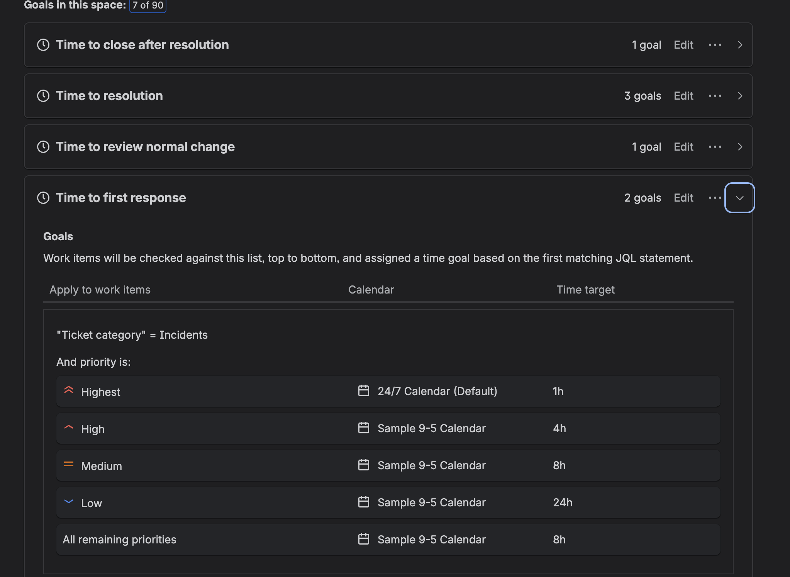

I also turned on the template's automation that emails a feedback survey when a request is resolved. When I first set it up, the condition checked whether the resolved date equaled one specific day (the day I created it), which meant it would never send a survey again after that day. I changed the condition to "resolved on a business day," so it keeps working going forward and doesn't send surveys for tickets closed on weekends.

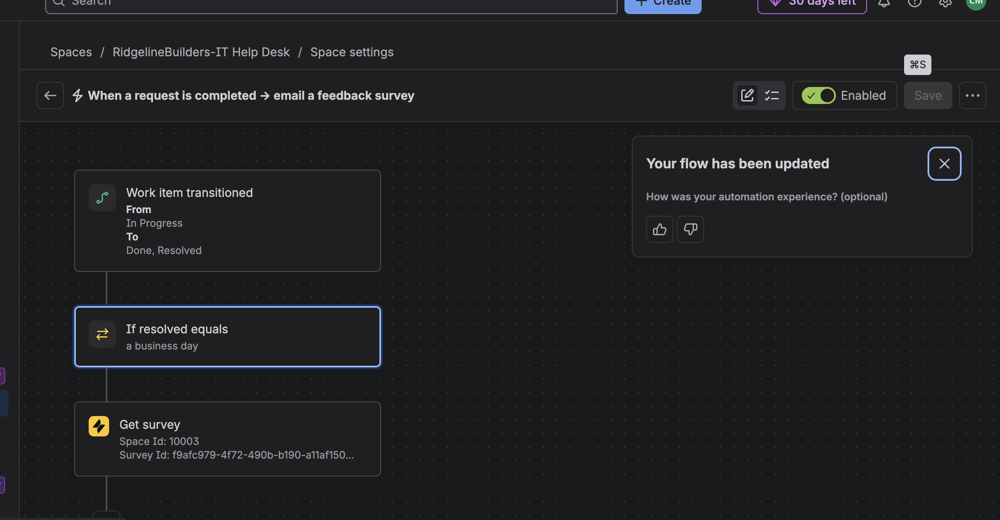

## The queue

Each ticket is a problem I actually ran into in Projects 1 through 4, logged under the employee who would have reported it.

| Key | Requester | Summary | Type |
| --- | --- | --- | --- |
| RIT-1 | Office manager | New hire Jordan Hayes starts Monday | Onboard new employees |
| RIT-4 | Superintendent | Microsoft 365 apps never installed on my new laptop | Get IT help |
| RIT-5 | Superintendent | My laptop shows "not compliant" (BitLocker, Secure Boot) | Get IT help |
| RIT-6 | Project manager | Can't sign into Teams, says "email not recognized" | Fix an account problem |
| RIT-8 | Superintendent | Maple St trailer Wi-Fi down, crews can't upload daily reports | Report a system problem |

All five tickets are resolved, and the open queue is empty. RIT-7 shows as canceled because it was my first attempt at the Wi-Fi ticket, which I logged as "Investigate a problem" and then replaced with RIT-8. In IT service management, an incident is something broken right now that needs service restored, and a problem is the underlying cause behind one or more incidents. A jobsite losing Wi-Fi is an incident.

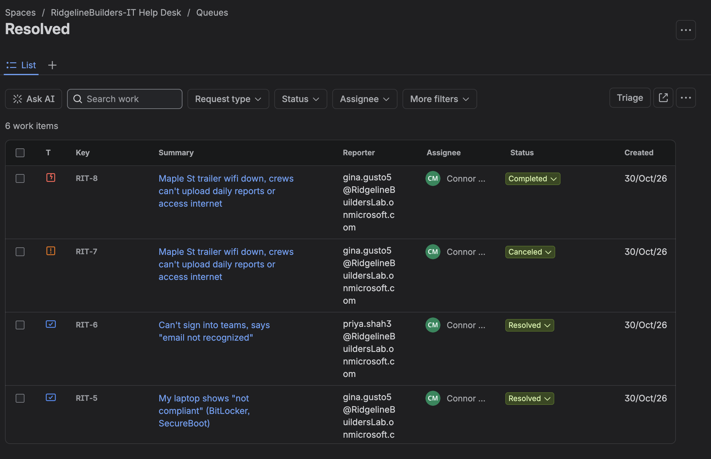
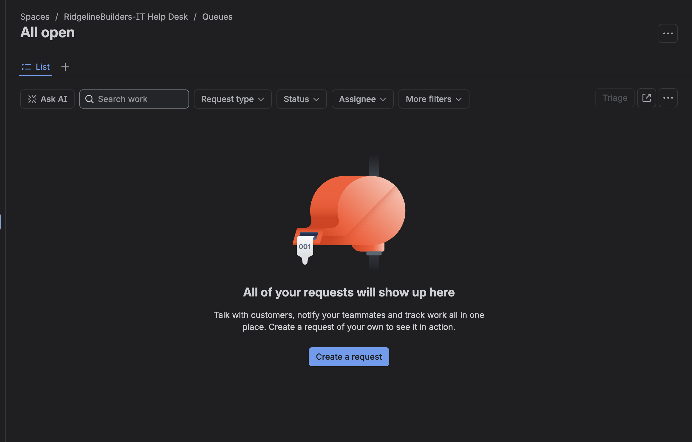

## Example: RIT-4, apps never installed

For each ticket I write two things: an internal note for other IT staff with exactly what I checked, and a reply to the user in plain language.

The internal note:

> Checked Intune > Apps > Microsoft 365 Apps > Device install status: 0 devices, not even pending. Apps are assigned as required for the SG-Field group. Checked SG-Field members, and Gina is not a member. Added Gina to SG-Field and re-synced the device. Application installs began and finished under 30 minutes later.
>
> Root cause: user was missed from her role group during onboarding. Ran the group audit (Get-GroupAudit.ps1) to check for any other missed members; none were found.

The reply to Gina:

> Hi Gina, thanks for reporting this issue. Your account was missing a setting that told your device what apps were needed on it. We fixed that setting, you now have access to all the apps, and they will be downloaded within the hour. Push out another ticket if they do not install after that time period.

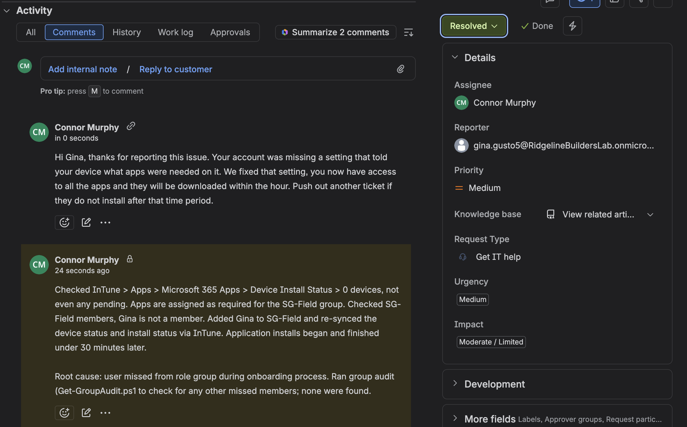
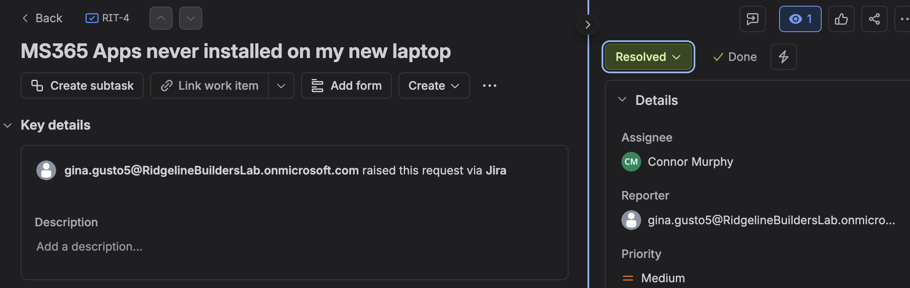

## Example: RIT-5, laptop not compliant

This one is harder to reply to, because the honest answer is that it can't be fixed on this device.

The internal note:

> Recently created a new compliance policy, CP-Windows-Baseline, as a baseline standard for all company devices. Checked Intune > Devices > Gina's laptop > Device compliance. Compliant: firewall, Defender antimalware, real-time protection, minimum OS version, and TPM. Not compliant: BitLocker and Secure Boot.
>
> The BitLocker policy under Endpoint security > Disk encryption showed Succeeded for her device, but `manage-bde -status C:` showed the drive fully decrypted with no encryption started. `Get-Tpm` returned TpmPresent and TpmReady as True. Event Viewer (BitLocker-API) showed two errors: "Failed to enable silent encryption, TPM not available" and "BitLocker detected bootable media in the device."
>
> The Windows installer ISO was still attached as a virtual CD and the startup disk was set to it. Detached the ISO and set the startup disk back to the hard drive, which cleared the bootable media error. `msinfo32` then showed Secure Boot off. Enabled UEFI Secure Boot in the VM settings and restarted; Secure Boot showed on, but BitLocker still would not encrypt. `msinfo32` run as administrator showed PCR7 Configuration: Not available.
>
> Root cause: VMware Fusion's virtual firmware on Apple Silicon doesn't provide PCR7 measurements, so BitLocker can't seal its key to the TPM and silent encryption fails. Recommend replacing with a physical company laptop. Policy delivery is confirmed working.

The reply to Gina:

> Hi Gina, thanks for letting us know. The warning is about one security feature, drive encryption, that can't be turned on with the way your laptop is set up. Nothing is wrong with your account, and you can keep working normally in the meantime.
>
> To fix it properly, we'll swap your current setup for a standard company Windows laptop, where encryption works automatically. I'll reach out this week to set up a time to get it to you at the Maple St site. If the warning starts blocking anything before then, just reply here.

The reply follows a pattern I'm trying to use for every ticket: what happened, whether the user is affected, what happens next, and what to do if anything changes. It leaves out the technical details, since Gina doesn't need to know what PCR7 is to understand what's going on.

The note I first posted in Jira had a typo ("PRC7") and skipped the step where I detached the installer ISO. Instead of rewriting it, I added a second internal note with the correction, so the ticket history stays accurate.

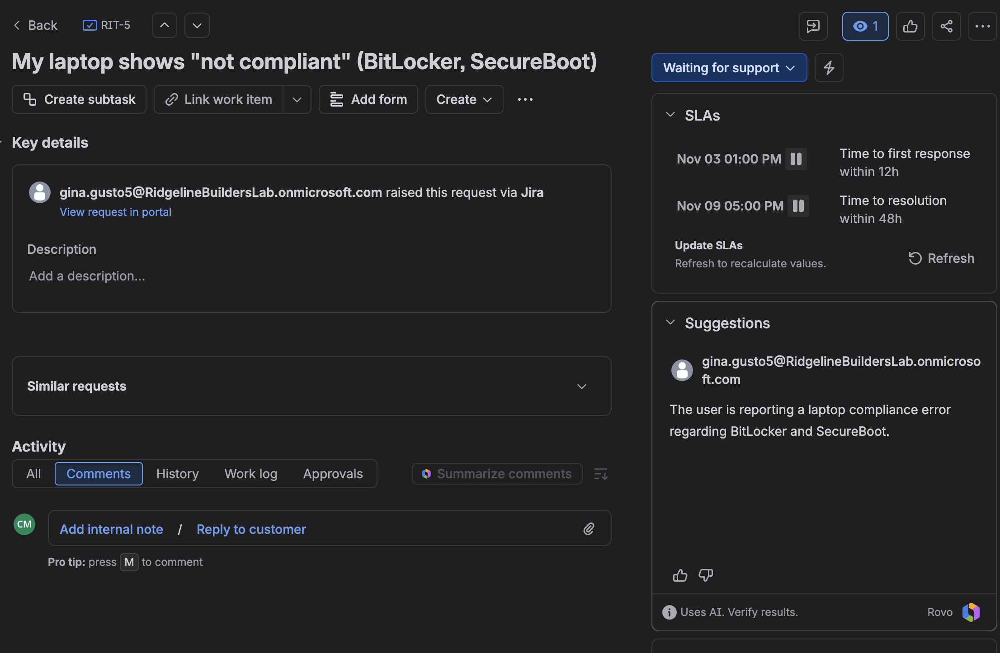
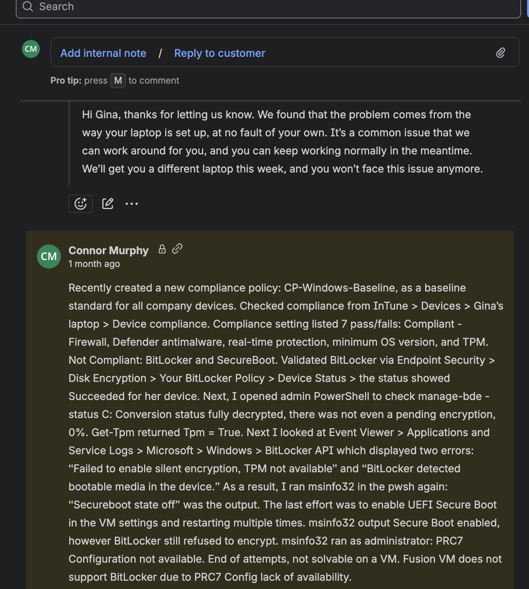

## RIT-8: Maple St trailer Wi-Fi down

This was the highest priority ticket, since a whole crew couldn't work.

The internal note:

> A guest laptop at the Maple St trailer showed an IP of 169.254.8.201. That's a self-assigned address, meaning DHCP never responded to the request. The wireless link had dropped, so DHCP never answered.
>
> Why did this happen? The SSID on AP-GUEST was named incorrectly, so the laptop couldn't find the network it was configured for.
>
> The fix: renamed the SSID, and the laptop rejoined, was assigned an address in 10.20.30.x, and was able to load http://8.8.8.8. Also worth noting, `show ip dhcp binding` showed a stale lease from before the SSIDs were named.

The reply to Gina:

> Hi Gina! Thanks for the request here. Good news, we discovered what the issue was and resolved it. Your crews are now back online, just have everybody refresh and/or restart their devices. No other actions are necessary.

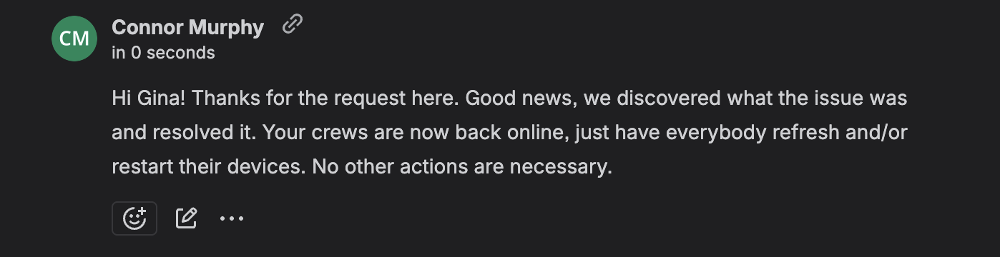

## RIT-6: Teams sign-in

This was a user education ticket more than a technical one.

The internal note:

> Priya submitted a request stating that Microsoft Teams sign-in was denying her access with the error "Email not recognized." I checked her URL and found that she was attempting to sign in at teams.live.com. This is the consumer, or "free," version of Teams, and it does not accept work accounts. I directed Priya to teams.microsoft.com, the business version of Teams, and she signed in successfully with her work email address.

The reply to Priya:

> Hi Priya! Thanks for the ticket. I see your work login is not allowing you access to teams.live.com. This is a free version of Teams. Ridgeline uses the business version at teams.microsoft.com. Go ahead and use your login at that link and you should be logged in successfully. Also, bookmark this page to ensure the right link every time. Let me know if you have any issues with that!

I wanted the reply to fix the problem without making Priya feel like she'd made a mistake, and the bookmark tip is there so it doesn't happen again.

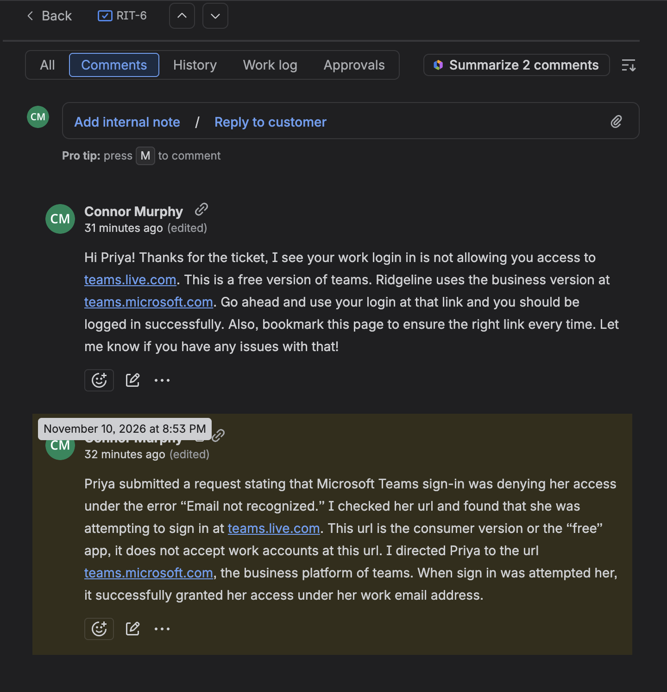

## RIT-1: New hires

The office manager asked for two new hires to be ready for Monday. This ticket is where the onboarding script from Project 2 and Autopilot from Project 3 came together.

The internal note:

> Two new hires are being onboarded this upcoming Monday: Jordan Hayes (Carpenter, Field) and Maria Lopez (Assistant PM, Operations). I ran New-RidgelineUser.ps1 with -WhatIf first, then for real. Both new hires were added to their role groups and to SG-Licensed-BusinessPremium, so they were licensed automatically. Both were given a temporary password that they must change at first sign-in, and CA01 requires MFA setup at first sign-in. Jordan's laptop was deployed by Autopilot on his first sign-in.

The reply to Adam:

> Hi Adam, Jordan and Maria are all set up for Monday. I'll call you on Monday morning with their temporary passwords so you can hand them over in person. When they first sign in, they'll choose a new password and set up the Microsoft Authenticator app, so make sure they have their phones with them. Jordan's laptop will set itself up automatically when he signs in. If anyone gets stuck, just reply here and I'll help.

Adam is the manager, not the new hire, so the reply tells him what he needs to do before Monday. The temporary passwords go to him by phone, not in the ticket, since anything written in a ticket or email can be read by whoever has access to it later.

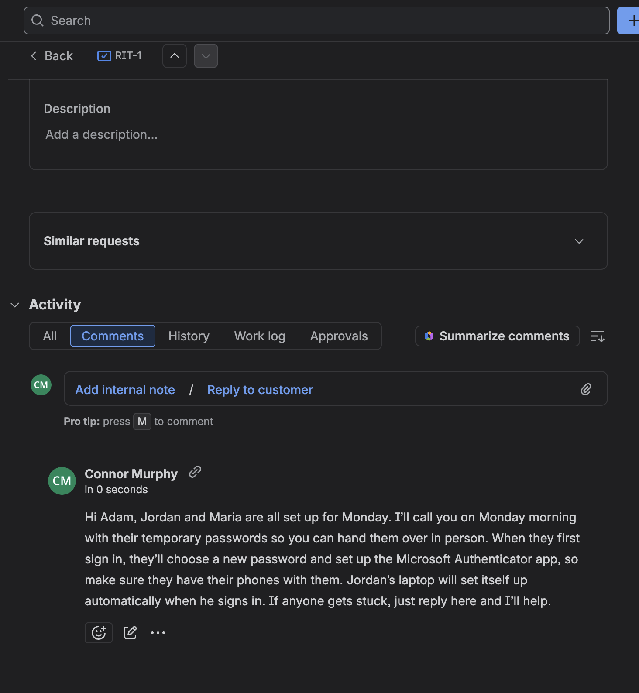

## Problem record: users missed from groups

Each incident above was fixed on its own, but RIT-4 had a cause that would keep producing new tickets: Gina was missing from her role group because accounts set up by hand don't follow a checklist, and a step got missed. Licenses and app assignments depend on group membership, so every missed group means another user without apps or access.

In IT service management, that's a problem rather than an incident. The incident fix for RIT-4 was adding Gina to her group. The problem fix is making sure nobody gets missed again. I logged it as RIT-9 and linked it to RIT-4.

The permanent fix is two things I'd already built in Project 2: all onboarding goes through `New-RidgelineUser.ps1`, which adds the role and license groups automatically, and `Get-GroupAudit.ps1` runs monthly to catch anything that slips through.

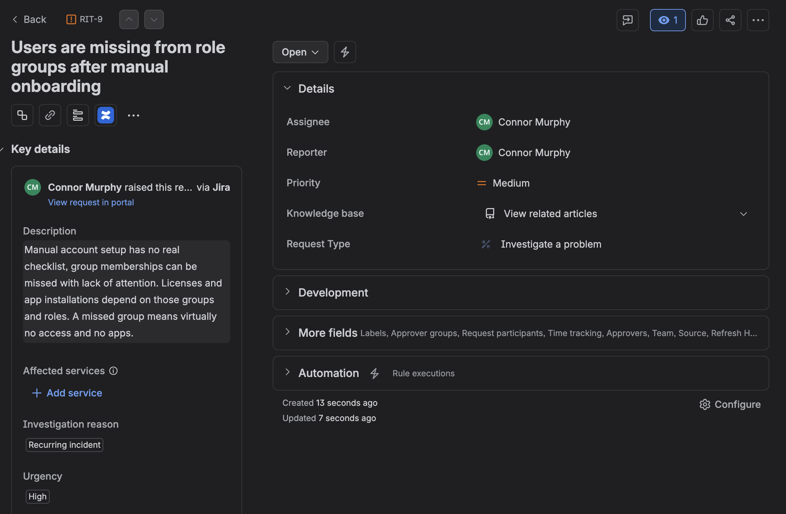

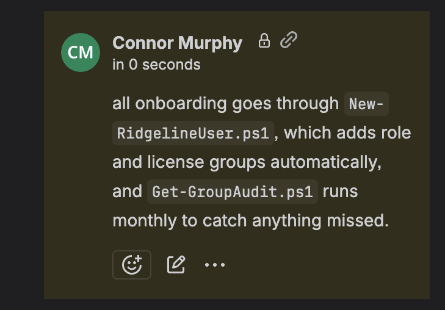

## Runbooks

A big part of help desk work is making sure the next person can do the same job without having to ask. I wrote runbooks for the tasks that came up most in this lab, based on what actually happened when I did them, including the mistakes:

| Runbook | Covers |
| --- | --- |
| [Onboarding](runbooks/onboarding.md) | Creating a new hire's account with the onboarding script, licensing, laptop, and first-day sign-in |
| [Offboarding](runbooks/offboarding.md) | Cutting off access on the last day without losing mailbox data, and collecting equipment |
| [Jobsite setup](runbooks/jobsite-setup.md) | Building a trailer network with separate staff, device, and guest Wi-Fi, plus sign-off tests |
| [Wi-Fi troubleshooting](runbooks/troubleshooting-wifi.md) | "Connected but nothing works," starting from the device's IP address |
| [VPN troubleshooting](runbooks/troubleshooting-vpn.md) | A jobsite that can't reach the office, from the internet link up to the tunnel |
| [Escalation template](runbooks/escalation-template.md) | What to include when passing an issue to a vendor or the IT Director, with an example |
