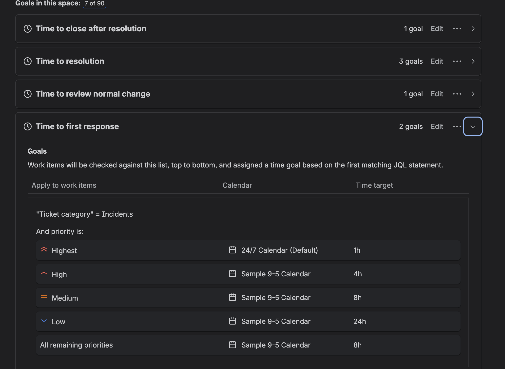
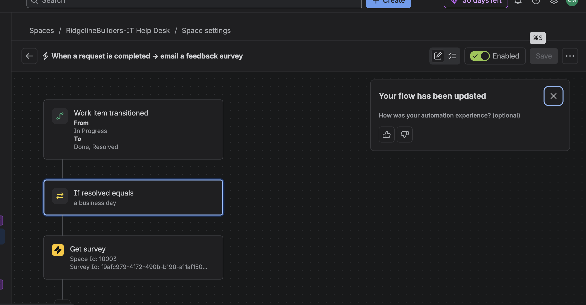
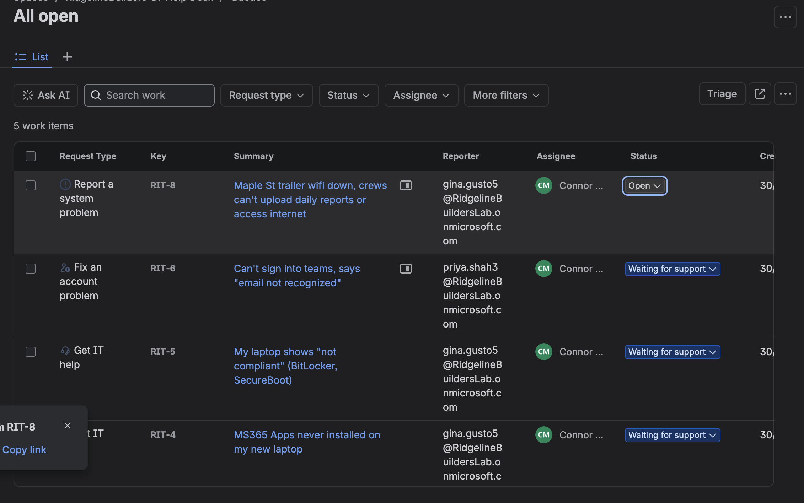
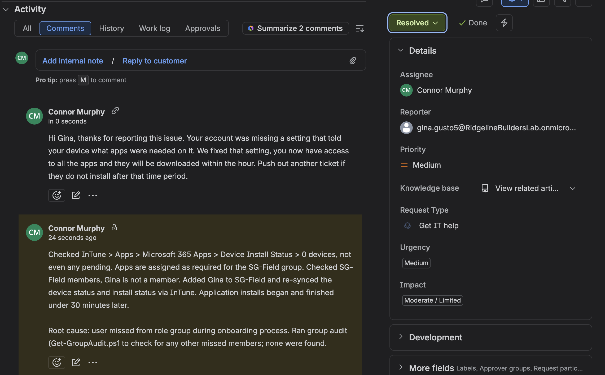
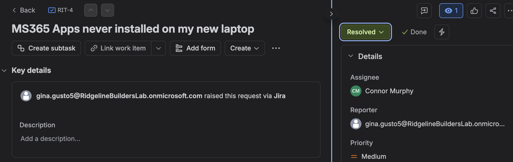
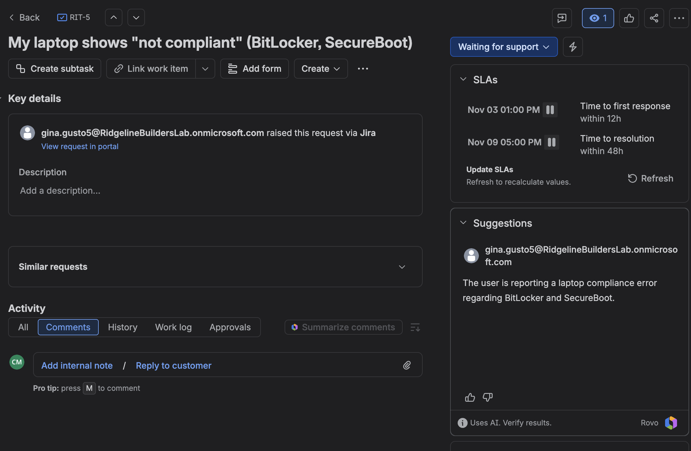
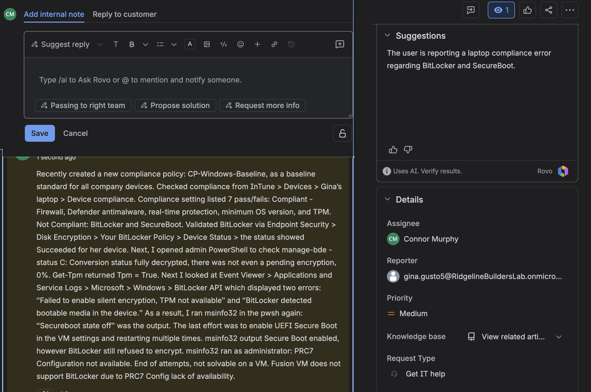

# Project 5: Help Desk and Documentation

This project is still in progress.

For this project I set up a help desk in Jira Service Management and ran the problems from my earlier projects through it as real tickets. The goal is to practice the part of IT support that happens around the technical fix: logging the request, keeping notes another tech could follow, explaining the fix to the user in plain language, and spotting patterns behind repeat issues.

## Setup

I created a service space called RidgelineBuilders-IT Help Desk using the IT service management template, with the ticket key `RIT`. The employees from my Microsoft 365 tenant are set up as customers, so I can raise tickets on their behalf the way a help desk would when someone calls in.

The customer accounts show up as their lab email addresses instead of names. Jira only lets the person who owns an account change its display name, and I decided it wasn't worth signing into every lab mailbox to accept the invites.

## SLAs

Jira keeps response time targets separate from the priority field, in a feature called SLAs. I set the time to first response for incidents by priority:

| Priority | Calendar | Target |
| --- | --- | --- |
| Highest | 24/7 | 1 hour |
| High | 9 to 5 | 4 hours |
| Medium | 9 to 5 | 8 hours |
| Low | 9 to 5 | 24 hours |

Highest priority runs on a 24/7 clock because it's meant for things like a jobsite losing its internet, where a whole crew can't work. Everything else pauses overnight. Service requests that aren't incidents fall under the template's default goals instead, which is why the laptop compliance ticket below shows 12 and 48 hour targets.

I also turned on the template's automation that emails a feedback survey when a request is resolved. When I first set it up, the condition checked whether the resolved date equaled one specific day (the day I created it), which meant it would never send a survey again after that day. I changed the condition to "resolved on a business day," so it keeps working going forward and doesn't send surveys for tickets closed on weekends.

## The queue

Each ticket is a problem I actually ran into in Projects 1 through 4, logged under the employee who would have reported it.

| Key | Requester | Summary | Type |
| --- | --- | --- | --- |
| RIT-1 | Office manager | New hire Jordan Hayes starts Monday | Onboard new employees |
| RIT-4 | Superintendent | Microsoft 365 apps never installed on my new laptop | Get IT help |
| RIT-5 | Superintendent | My laptop shows "not compliant" (BitLocker, Secure Boot) | Get IT help |
| RIT-6 | Project manager | Can't sign into Teams, says "email not recognized" | Fix an account problem |
| RIT-8 | Superintendent | Maple St trailer Wi-Fi down, crews can't upload daily reports | Report a system problem |

I first logged the Wi-Fi outage as "Investigate a problem," then moved it. In IT service management, an incident is something broken right now that needs service restored, and a problem is the underlying cause behind one or more incidents. A jobsite losing Wi-Fi is an incident.

## Example: RIT-4, apps never installed

For each ticket I write two things: an internal note for other IT staff with exactly what I checked, and a reply to the user in plain language.

The internal note:

> Checked Intune > Apps > Microsoft 365 Apps > Device install status: 0 devices, not even pending. Apps are assigned as required for the SG-Field group. Checked SG-Field members, and Gina is not a member. Added Gina to SG-Field and re-synced the device. Application installs began and finished under 30 minutes later.
>
> Root cause: user was missed from her role group during onboarding. Ran the group audit (Get-GroupAudit.ps1) to check for any other missed members; none were found.

The reply to Gina:

> Hi Gina, thanks for reporting this issue. Your account was missing a setting that told your device what apps were needed on it. We fixed that setting, you now have access to all the apps, and they will be downloaded within the hour. Push out another ticket if they do not install after that time period.

## Example: RIT-5, laptop not compliant

This one is harder to reply to, because the honest answer is that it can't be fixed on this device.

The internal note:

> Recently created a new compliance policy, CP-Windows-Baseline, as a baseline standard for all company devices. Checked Intune > Devices > Gina's laptop > Device compliance. Compliant: firewall, Defender antimalware, real-time protection, minimum OS version, and TPM. Not compliant: BitLocker and Secure Boot.
>
> The BitLocker policy under Endpoint security > Disk encryption showed Succeeded for her device, but `manage-bde -status C:` showed the drive fully decrypted with no encryption started. `Get-Tpm` returned TpmPresent and TpmReady as True. Event Viewer (BitLocker-API) showed two errors: "Failed to enable silent encryption, TPM not available" and "BitLocker detected bootable media in the device."
>
> The Windows installer ISO was still attached as a virtual CD and the startup disk was set to it. Detached the ISO and set the startup disk back to the hard drive, which cleared the bootable media error. `msinfo32` then showed Secure Boot off. Enabled UEFI Secure Boot in the VM settings and restarted; Secure Boot showed on, but BitLocker still would not encrypt. `msinfo32` run as administrator showed PCR7 Configuration: Not available.
>
> Root cause: VMware Fusion's virtual firmware on Apple Silicon doesn't provide PCR7 measurements, so BitLocker can't seal its key to the TPM and silent encryption fails. Recommend replacing with a physical company laptop. Policy delivery is confirmed working.

The reply to Gina:

> Hi Gina, thanks for letting us know. The warning is about one security feature, drive encryption, that can't be turned on with the way your laptop is set up. Nothing is wrong with your account, and you can keep working normally in the meantime.
>
> To fix it properly, we'll swap your current setup for a standard company Windows laptop, where encryption works automatically. I'll reach out this week to set up a time to get it to you at the Maple St site. If the warning starts blocking anything before then, just reply here.

The reply follows a pattern I'm trying to use for every ticket: what happened, whether the user is affected, what happens next, and what to do if anything changes. It leaves out the technical details, since Gina doesn't need to know what PCR7 is to understand what's going on.

## Still to do

- Work and resolve the rest of the tickets
- Log a lost phone ticket and fix it in the tenant with a Temporary Access Pass
- Create a problem record for users being missed from groups during manual onboarding, linked to RIT-4, with the onboarding script and monthly group audit as the permanent fix
- Write runbooks for onboarding, offboarding, jobsite setup, and common troubleshooting
- Write an escalation template for passing issues to vendors or the IT director
