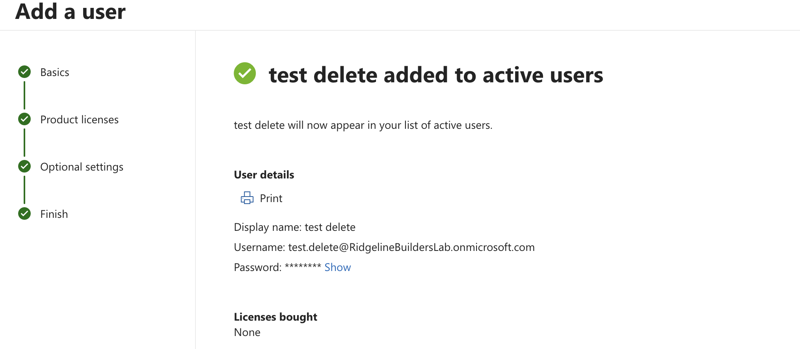
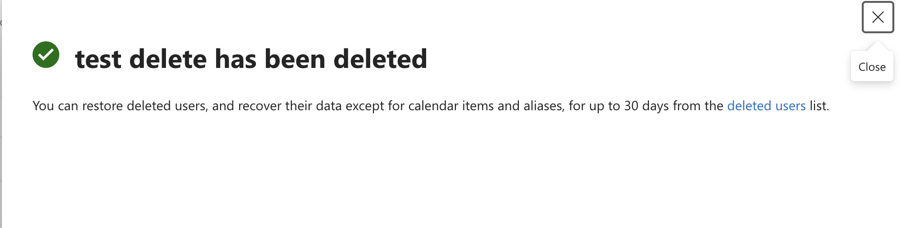
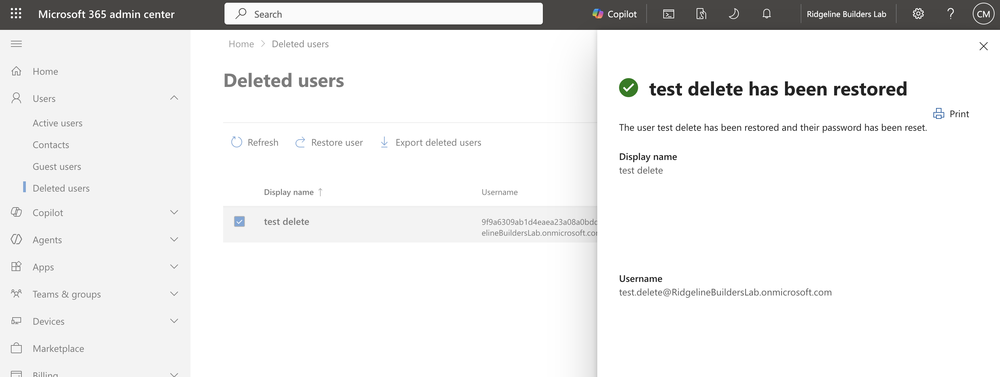
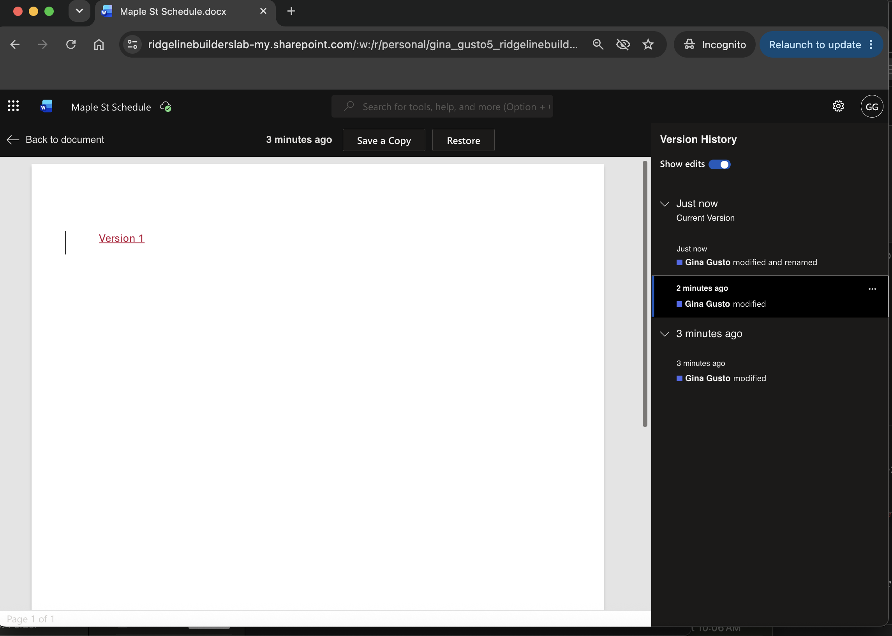
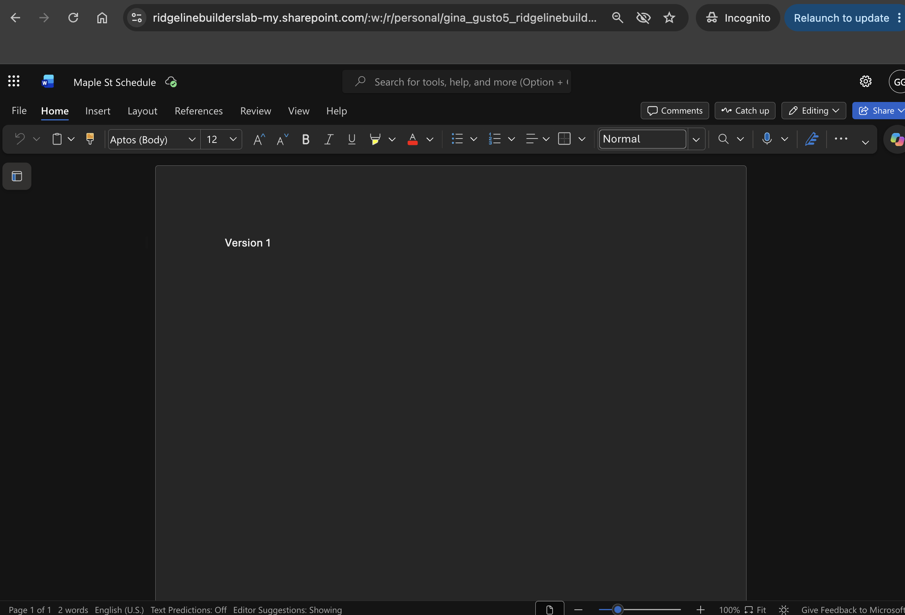
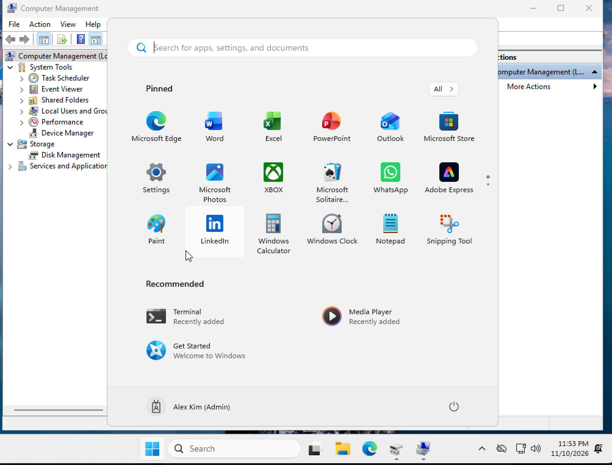
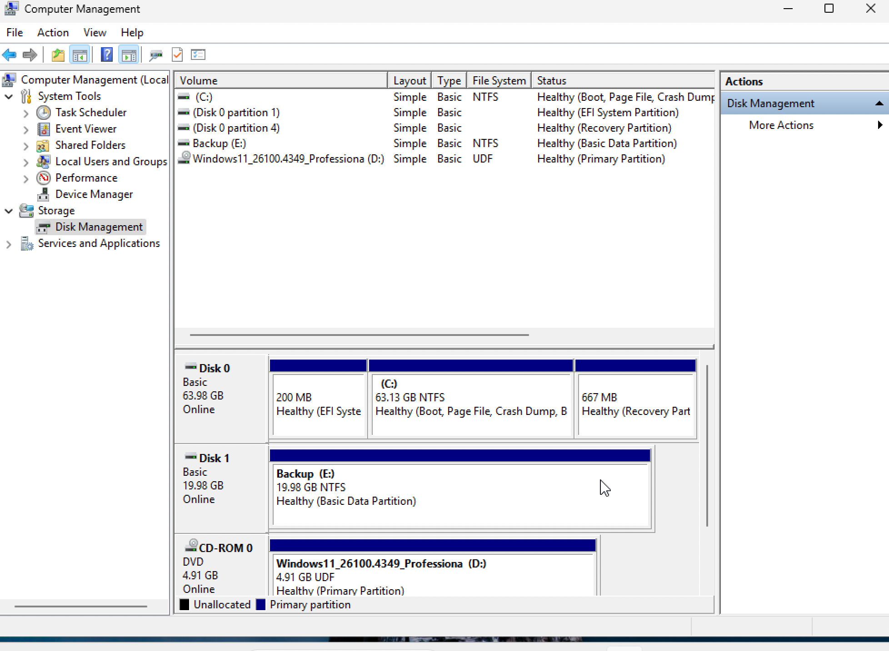
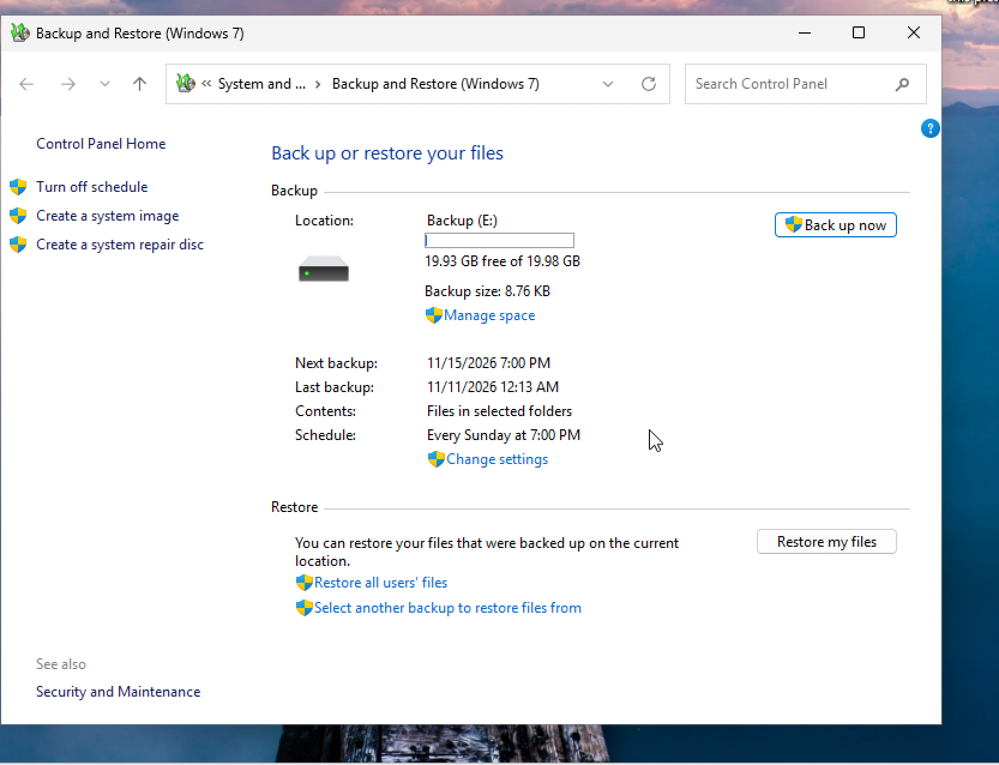
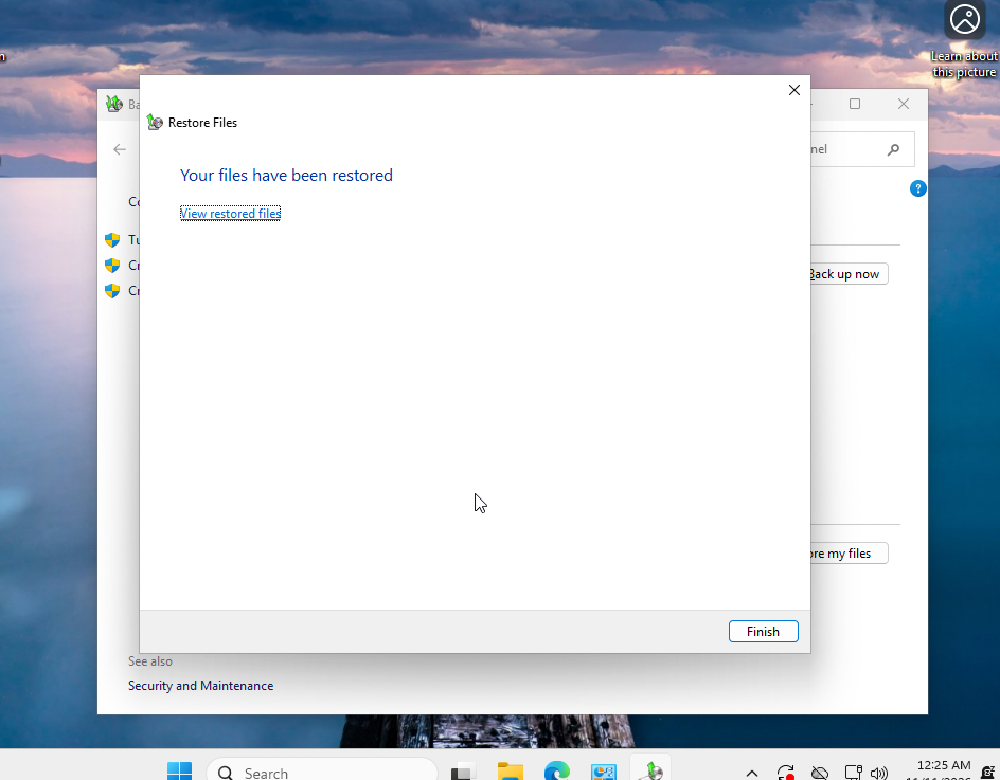
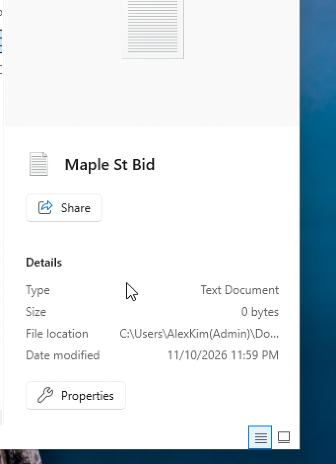

# Project 6: Backup and Restore Testing

A backup only counts if you've restored from it. For this project I tested the recovery options Ridgeline actually depends on: bringing back a deleted Microsoft 365 user, rolling a OneDrive file back to an earlier version, and restoring a deleted folder on a laptop from a local backup. I timed each one and recorded the results in a verification log.

The procedure and the log are in [backup-verification.md](backup-verification.md).

## Choosing the laptop backup tool

My plan was to use Veeam Agent for Windows. Before installing it, I checked vendor support. Veeam Agent only supports x86 processors, and my lab laptop is Windows 11 on Arm running in VMware Fusion on an M3 Mac. Users on the Veeam forums report that it can install and even take backups on Arm, but restores fail. A backup I can't restore from isn't useful, so I used the backup tools built into Windows instead.

My next choice was File History, but it wouldn't open on this build. Searching for it and running `control /name Microsoft.FileHistory` both did nothing. I used Backup and Restore (Windows 7) instead, which is still included in Windows 11 and opens with `sdclt`.

## Microsoft 365 recovery

### Deleted user

I created a test user, deleted it, and restored it from Deleted users in the Microsoft 365 admin center. Microsoft keeps deleted users for 30 days. After that they're gone for good.

One thing I didn't expect: restoring the user also reset their password. A restore isn't invisible to the employee. They need a new password from IT before they can sign in again, so that belongs in the restore steps.

### OneDrive file version

I made a Word document in a user's OneDrive and edited it a few times so it had several saved versions, the latest reading "Version 3." Then I opened Version history, selected the first version, and restored it. The document went back to reading "Version 1."

This is the fix for the most common real-world file problem: someone saves over a file and needs yesterday's copy. It takes seconds and doesn't need a backup product.

## Laptop backup and restore

### Adding the backup disk

I shut down the VM, added a second 20 GB virtual disk in Fusion, and formatted it as `E:` (GPT, NTFS, labeled Backup).

Disk Management wouldn't open from my regular account, which made sense. The laptop was set up through Autopilot, so the user signs in as a standard user, not a local admin. I tried Run as administrator with my IT admin account (admin.alex). It accepted the password but still failed with an elevation error.

The cause was that admin roles in Microsoft 365 don't give local admin rights on a device. When a device joins Entra ID, Windows only adds a couple of roles to its local Administrators group. admin.alex had neither. I assigned it the Microsoft Entra Joined Device Local Administrator role, signed in to the laptop once with that account to pick up the change, and then Computer Management opened as admin.

That role makes the account a local admin on every Entra-joined device. For a small company with one IT person that's reasonable. In a larger company I'd scope it more narrowly with an Intune local group membership policy.

### Backing up

In Backup and Restore I set the destination to `E:`, picked only the Documents folder, and turned off the system image. The test folder was `Documents\Ridgeline\ProjectFiles` with a couple of small text files. The backup runs every Sunday at 7 PM.

Before deleting anything, I browsed the backup and confirmed the ProjectFiles folder was actually in it.

### Restoring

I deleted the ProjectFiles folder, emptied the Recycle Bin, and restored it to its original location with Restore my files. The restore asked for admin credentials. On a locked-down laptop, an employee couldn't do this alone and would need to open a ticket. The whole thing took about 10 minutes, start to finish, including finding the folder in the backup and entering credentials.

### A file that came back empty

The folder and both files came back with the right names, but when I checked Maple St Bid, it was 0 bytes. I had typed text into it in Notepad, and the text was still there when I opened it after the restore.

The newer Notepad in Windows 11 keeps text you've typed between sessions even if you never save it to the file. So Notepad showed my text, but the file on disk was empty when the backup ran, and the backup correctly saved an empty file. The restore did its job.

The lesson for future tests is to check file size in Properties, not just open the file in an app that might be showing something else. It's also a useful thing to know for the help desk. If a user says "I typed it, why is the file empty," unsaved Notepad text is one possible answer.

## Notes

- The Windows VM's clock is an hour off from my Mac, so screenshots from the laptop show times an hour later than the real times. The times in the log are the real ones.
- In this lab the backup covered the admin account's Documents folder, since that's the account I was signed in as. On a real laptop it would be the employee's profile.
- I haven't tested recovering a deleted email yet.
